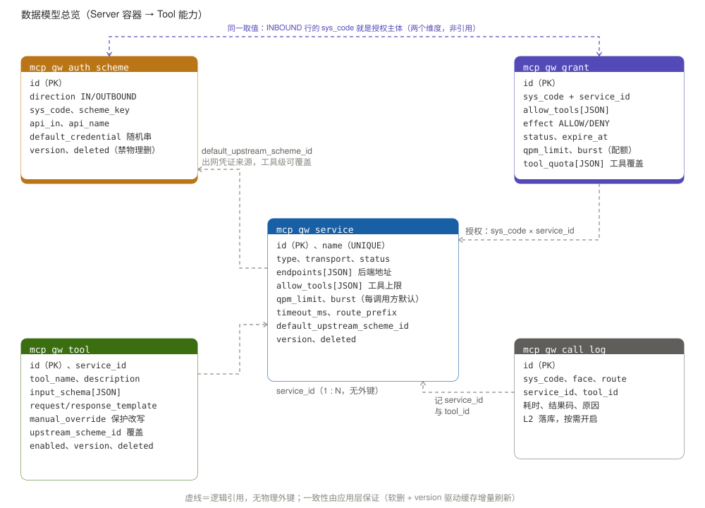

# MCP 网关设计方案

> **定位**：用 Java 自研的 MCP / API 网关。以数据库做轻量服务注册与发现，不依赖 Nacos / Consul，覆盖主流 MCP 网关的三类能力：
>
> 1. **REST/OpenAPI → MCP**：把后端 REST 服务按 OpenAPI 规范包装成 MCP 工具，供 Agent 调用；
> 2. **原生 MCP → 原生 MCP**：代理 / 聚合后端已有的 MCP Server，同协议透传；
> 3. **OpenAPI/REST → OpenAPI/REST**：普通 HTTP 反向代理与路由透传。
>
> **读者**：后端开发、SRE。本文档是设计与实现的唯一依据，表结构、配置项、关键代码路径以此为准。

---

## 1. 总体架构

```
                        ┌─────────────────────────────────────────────┐
   Agent / MCP Client ──┤  ① MCP 面 (StreamableHTTP, /mcp)             │
                        │     ├─ 聚合 tools/list（带缓存）              │
                        │     └─ 分发 tools/call（带授权校验）        │
   前端 / 后端系统 ──────┤  ② REST 代理面 (/proxy/**, HTTP 透传)        │
                        │     └─ 按 route_prefix 匹配、剥离后转发       │
  后端实例 / 运维后台 ───┤  ③ 管理面 (/internal/**, /admin/**, actuator)│
                        │     ├─ 注册 / 上下线                          │
                        │     └─ 注册表 CRUD、指标暴露                    │
                        └───────────────┬─────────────────────────────┘
                                        │
                        ┌───────────────▼──────────────────────────────┐
                        │            网关核心 (Spring Boot 3)            │
                        │  注册表(DB+缓存) │ 路由聚合 │ 鉴权 │ 限流 │ 审计 │
                        └───┬───────────┬──────────────┬──────────────┘
              原生MCP后端    │           │ OpenAPI/REST后端   │ REST上游
        (MCP client连接池) ◄┘           └►(swagger-parser+模板) ◄┘(RestClient透传)
                                        │
                    MySQL(mcp_gw_service / mcp_gw_tool /
                          mcp_gw_auth_scheme / mcp_gw_grant /
                          mcp_gw_call_log)
```

**一个进程、三个面、一套注册表**：入口按调用方隔离，后端能力由统一注册表驱动。

| 面              | 路径前缀                                      | 调用方             | 职责                                                      | 治理策略                                                |
| -------------- | ----------------------------------------- | --------------- | ------------------------------------------------------- | --------------------------------------------------- |
| **① MCP 面**    | `/mcp`                                    | Agent / MCP 客户端 | `tools/list` 聚合、`tools/call` 分发，工具名带 `{service}.` 前缀    | 入口鉴权 + 工具授权 + **集群限流**（主战场）                         |
| **② REST 代理面** | `/proxy/**`                               | 前端 / 业务系统       | 按 `route_prefix` 匹配后端，普通 HTTP 反向代理，方法 / query / 状态码原样透传 | 入口鉴权 + 集群限流；**不适用工具授权**（没有工具概念）                     |
| **③ 管理面**      | `/internal/**`、`/admin/**`、`/actuator/**` | 后端服务实例、运维后台     | 服务注册、注册表 CRUD、指标暴露                                      | **不承载业务流量、不对外网暴露**：走独立监听端口；内网调用同样校验凭证，注册接口单独做低频配额防刷 |

「面」与「链路」是两个维度：**面**指网关暴露给谁的入口，**链路**指后端类型是原生 MCP / OpenAPI / REST 上游。同一个 MCP 面进来，按注册表里的服务类型走不同链路。

> **边界**：管理面只做配置与观测，**不做数据面的旁路**——服务治理策略（授权 / 限流 / 鉴权）全部在①②面强制执行，管理面即使被误触达也不能绕过任何一条校验。

### 1.1 技术选型

| 层                 | 选型                                                | 说明                                                       |
| ----------------- | ------------------------------------------------- | -------------------------------------------------------- |
| 语言/框架             | Java 25 LTS + Spring Boot 3.x                     | 主栈；内网只批 JDK 21 时零改动切换（见下）                                |
| MCP 协议（对外 Server） | 官方 MCP Java SDK `io.modelcontextprotocol.sdk:mcp` | 自行实现聚合，比自动装配更可控                                          |
| MCP 协议（对内连原生后端）   | 官方 SDK 编程式 `McpSyncClient` 连接池                    | 动态发现必须手写连接，不能用启动时绑定固定后端的 starter                         |
| 阻塞调用隔离            | 虚拟线程 + 信号量舱壁                                      | 同步调用不得占用容器线程；舱壁限并发，缺一不可                                  |
| OpenAPI 解析        | `io.swagger.parser.v3:swagger-parser-v3`          | 解析 spec 生成工具 schema 与转发模板                                |
| HTTP 转发           | `RestClient`（同步）/ `WebClient`（SSE 流式）             | REST→MCP、REST→REST 透传                                    |
| 模板渲染              | 自研 `{{}}` 渲染 + JsonPath                           | 内置 `toJson` / `urlEncode` 两个必用函数                         |
| 存储                | MySQL 8 + MyBatis-Plus                            | 服务 / 认证方案 / 工具注册表                                        |
| 本地缓存              | Caffeine                                          | 注册表快照 + 后端工具列表缓存                                         |
| 限流                | Redis（哨兵/Cluster）+ Lua 令牌桶                        | 集群限流，Redis 为唯一事实源                                        |
| 鉴权                | API Key（Spring Security）                          | 入口校验调用方；网关→后端默认用固定 Key                                   |
| 凭证存储              | **明文随机字符串**（网关签发 `gw_sk_` + 256 bit 随机）           | `mcp_gw_auth_scheme.default_credential`；取舍与补偿控制见 7.1-C    |
| 观测                | Micrometer + Prometheus + 结构化日志                   | 三面全路由统一埋点，**以 `sys_code` 为主维度**：调用量、时延、错误、拒绝、告警          |
| 部署                | Docker / K8s Deployment + HPA                     | **MCP 面无状态**，可任意扩缩                                       |

> **JDK 版本策略**：编译目标用 `maven.compiler.release=21` 锁死，代码不引入任何 22+ 的 API——运行时给 JDK 25 跑 25、内网准入只批 21 就跑 21，切换零改动；若误用了 25 才有的 API，编译期即报错，版本决策被推迟到部署时刻且随时可逆。选 25 的理由：同为 LTS，且 JDK 24 起修复了虚拟线程在 `synchronized` 块内阻塞 pin 住载体线程的问题（JEP 491）——21 上需加 `-Djdk.tracePinnedThreads=full` 观测，25 上无此顾虑。

### 1.2 无状态与水平扩展 — 暂不考虑

> **协议版本优先**：MCP `2026-07-28` 起已移除 `initialize` / `notifications/initialized` 与协议级 `Mcp-Session-Id`，改为**请求自描述的无状态模型**（方法名与工具名进 HTTP Header）。本方案以该版本为准，此时会话概念已不存在，天然无状态。若 SDK 或客户端尚不支持，退回旧版本时按下方「兼容」处理。

**网关是无状态的，并且只有这一种模式**：进程内存里不保存任何跨请求的调用方上下文，不颁发 `Mcp-Session-Id`，**每个 HTTP 请求自带完整上下文**（凭证、工具名、入参），任何副本都能独立处理任一请求。

跨请求的数据只有三类，且都不在 Pod 内存里：

| 数据                  | 存在哪                 | 丢了会怎样                           |
| ------------------- | ------------------- | ------------------------------- |
| 注册表快照（服务 / 工具 / 授权） | Caffeine，由 DB 重建    | 重建耗时毫秒级，期间请求短暂变慢，不会失败           |
| 集群限流计数              | Redis（7.2）          | Redis 挂则 fail-open + 告警         |
| 后端工具列表缓存            | Caffeine，TTL 30~60s | 到期重拉一次 `tools/list`，结果不变        |
| 连接池（网关→后端）          | Pod 内存，见 3.4        | Pod 重建时连接重建，**不影响调用方那条请求的处理结果** |

因此 HPA 可以任意扩缩、Pod 可以随意重建、滚动发布不需要排空任何状态——这也是后端地址可以不留"下线过渡期"、直接从 `endpoints` 删除的原因（2.1）。**同一调用方的两次连续请求落到不同 Pod，行为完全一致。**

**兼容旧版本客户端 / 后端**

- **上行（调用方 → 网关）**：不对齐旧版本的话，SDK 会按 `Mcp-Session-Id` 在内存里保存 transport，多副本下客户端第二次请求落到别的 Pod 即失败。所以网关**强制走 SDK 的 stateless 配置，不颁发 `Mcp-Session-Id`**；调用方若仍带上该头，**一律忽略**，只按当前这一个请求处理；
- **下行（网关 → 要求握手的 legacy `MCP_REMOTE` 后端）**：会话由**网关作为 client 代持**，握手与断线重连全部封装在 3.4 的连接池里。这部分状态只存活于单个 Pod 的传输层，不上行暴露给调用方；Pod 重建时它随之失效，由连接池自己重连，**不会让调用方感知到某个旧会话存在过**；
- 协议边界处丢弃 `Mcp-Session-Id` / `Cookie` / `Authorization`，**不把下游会话透给上游**（5.1）。

**无状态模式的三条固有约束**：

1. **不能向客户端主动推送**：`notifications/tools/list_changed` 不可用，`initialize` 里 `tools.listChanged` 声明为 `false`。工具列表变化只能由调用方下次 `tools/list` 感知，或等网关侧缓存 TTL 到期（2.7）；
2. **不能断点续传**：没有 `Last-Event-ID` 重放，SSE 流中断即丢。需要续传能力的调用方不成立，由它自己重发整个请求；
3. **`prompts` / `resources` 返回空列表**而不是报错（一期不支持这两类能力）。

> **范围声明：不做会话保持。** 会话亲和（sticky session）与会话外置到 Redis（含 `EventStore` 事件重放）**两种做法都不做**。前者依赖 Ingress 具体实现，滚动发布、扩缩容、Pod 重建时会话都会漂移或丢失，等于把可用性押在流量调度上；后者要把 SSE 连接的 TCP 状态管理引入网关、并让 Redis 成为新的强依赖，而它换来的收益（服务端推送、断点续传）在当前用例下不成立。**将来若确实需要，属于新版本的能力增量，而不是一个配置项开关。**

---

## 2. 数据模型（注册表设计）

### 2.0 模型总览

采用 **Server 容器 → Tool 能力** 两层模型。**所有表统一 `mcp_gw_` 前缀**（网关自有资产，与业务库表区分，便于授权、迁移与识别）：



关系说明（虚线全部是**逻辑引用，无物理外键**）：

| 关系                                      | 承载字段                                  | 语义                                        |
| --------------------------------------- | ------------------------------------- | ----------------------------------------- |
| `mcp_gw_tool` → `mcp_gw_service`        | `service_id`                          | 1 : N，一个 Server 容器下挂多个 Tool 能力            |
| `mcp_gw_service` → `mcp_gw_auth_scheme` | `default_upstream_scheme_id`          | 服务默认的后端出网凭证；单工具可用 `upstream_scheme_id` 覆盖 |
| `mcp_gw_grant` → `mcp_gw_service`       | `sys_code` + `service_id`             | 哪个外部系统对这个服务被授予了哪些工具（授权的唯一依据）              |
| `mcp_gw_grant` ⇠ `mcp_gw_auth_scheme`   | 两边同一个 `sys_code`                      | 授权主体取 `direction=INBOUND` 行的 `sys_code`   |
| `mcp_gw_call_log` → 上述三者                | `sys_code` / `service_id` / `tool_id` | 调用日志按与监控、限流同一口径记录                         |

| 层             | 表                    | 管什么                                                                                                                                   |
| ------------- | -------------------- | ------------------------------------------------------------------------------------------------------------------------------------- |
| **Server 容器** | `mcp_gw_service`     | 名字（=工具命名空间）、类型、**后端地址 `endpoints`**、spec 地址、**服务侧工具上限 `allow_tools`**、超时、透传开关、状态                                                      |
| **Tool 能力**   | `mcp_gw_tool`        | 挂在某服务下的具体可调用操作：工具名、描述、入参、请求/响应模板、开关、认证覆盖                                                                                              |
| **认证方案**      | `mcp_gw_auth_scheme` | 统一 APIKEY；`INBOUND` 行带 `sys_code`（外部调用方系统码，监控 / 限流 / 授权 / 日志主维度），`OUTBOUND` 行为后端出口凭证——链路二 / 三按模板注入，链路一装配到 transport（3.4），被服务默认值或单工具引用 |
| **调用方授权**     | `mcp_gw_grant`       | **哪个外部系统（`sys_code`）、对哪个服务、能用哪些工具**，管理员授予并持久化（2.5）                                                                                    |
| **调用日志**      | `mcp_gw_call_log`    | 每次调用的调用方、服务、工具、入参摘要、耗时、结果码                                                                                                            |

三类服务类型下工具的来源不同：

| type                     | tools 从哪来                          | 是否入库 `mcp_gw_tool`          |
| ------------------------ | ---------------------------------- | --------------------------- |
| `OPENAPI_REST`（REST→MCP） | swagger-parser 解析 operation 生成静态定义 | ✅ 入库，随 spec 刷新（人工改过的不覆盖）    |
| `MCP_REMOTE`（原生 MCP 代理）  | 连上后端后 `tools/list` 运行时动态枚举         | ❌ 不入库，按 2.6（服务上限 ∩ 调用方授权）裁剪 |
| `REST_PROXY`（REST 透传）    | 无工具概念，纯 HTTP 路由                    | ❌ 不使用 `mcp_gw_tool`         |

**多地址为什么不单独建表**：`name` 是工具命名空间必须唯一，而多地址只是一组可替换的连接目标。把地址收进 `endpoints` JSON 数组后，服务级配置（工具上限 / 超时 / 透传开关）只存一份，不会在多行间冗余漂移，也省掉一套 CRUD、缓存聚合与级联逻辑。


`endpoints` 结构：

```json
[
  {"url": "http://order-svc-a:8080/mcp", "weight": 100},
  {"url": "http://order-svc-b:8080/mcp", "weight": 100}
]
```

- **单地址简写**：`[{"url": "http://order-svc:8080/mcp"}]`（`weight` 缺省 100）——绝大多数服务就是这个形态；`url` 只允许 `http` / `https`，数组内不得重复；
- **这一列只登记"有哪些后端可选"，是静态登记事实**。**端到端能不能连，不写在这里**——它属于每个 Pod 内存里的运行期状态（2.7、3.4），不落库、不跨副本同步；
- 服务级 `status` 因此也只有两个语义：`ONLINE`（已登记、未停用）与 `DISABLED`（人工停用），与 `endpoints` 里各地址的运行期状态无关。`endpoints` 为空数组时选址无候选，按快速失败处理（记 `SERVICE_OFFLINE`），这是预期行为不是异常。

**健康判定一期只有一种方式：真实请求的结果。** 不做心跳上报、不做后台周期性 `ping` 探活，也没有"健康 / 不健康"的落库状态：

- **注册进来即视为可用**（默认可用）。后端实例的存亡由基础设施负责——`SIGTERM` → 摘除 EndpointSlice → 宽限期处理存量 → 退出，网关侧看到的就是连接中断或调用失败，**这已经够了**；
- **唯一的离线来源是被动失败计数**：某个地址连续失败达阈值（如 5 次）就把它从候选里剔除一段时间（熔断）；
- **恢复也是被动的**：冷却期（默认 5s）过后**放行一个真实请求去试探**，成功则恢复可用并清零计数，失败则继续剔除并重置冷却计时。这就是半开，不需要后台线程和额外探测流量；
- 代价要写在前面：**被熔断的地址如果之后完全没有流量，它会一直停在不可用状态**，直到下一次有请求来试探。这在"单地址 + 常态有流量"的场景下不成问题，方向也是 fail-safe（宁可不选一个已知在失败的地址）；需要立刻拉回时由管理员手动清除该 Pod 的计数或重新注册。

> 将来要做主动健康检测（心跳上报 / 后台定时探活）时的扩展点很明确：`endpoints[]` 元素加回 `status` / `last_heartbeat`，管理面加一个上报接口，**选址与熔断这套判定逻辑不用动**——它本来就只看"这个地址当前能不能用"这一个布尔值，至于这个值是心跳算出来的还是失败计数算出来的，对它没有区别。这也是为什么现在不把它写进 JSON：多了状态字段，就要回答写入频率、整行乐观锁冲突、跨副本不一致、探测结果与被动计数打架时听谁的这一串问题，而它们目前换不来任何新能力。

**「下线」是分层的，四个层次各走各的路子**——这里最容易搞混，尤其不要把服务停用做成删数据：

| 想做的事                     | 怎么做                                | 还剩下什么                     | 恢复             |
| ------------------------ | ---------------------------------- | ------------------------- | -------------- |
| **停用一个服务**（最常用的"下线"）     | `mcp_gw_service.status = DISABLED` | 工具、工具所属授权、`endpoints` 全保留 | 置回 `ONLINE` 即可 |
| **摘掉某一个后端地址**（多地址里少一个实例） | 从 `endpoints` 数组**删除该元素**          | 其余元素不变；服务本身还在             | 重新注册，或写回数组     |
| **单个工具临时停**              | `mcp_gw_tool.enabled = 0`          | 工具定义与模板保留                 | 置回 `1`         |
| **彻底废弃、不打算要了**           | 软删 `deleted=1`，并连带处理工具与授权（见下方约定）   | 行还在但不参与任何查询               | 不计划恢复          |

一句概括：**临时收回一律用 `status` / `enabled` 字段，不改数据；永久移除才动数据。** 这也是 `mcp_gw_grant.status`（`ENABLED` / `DISABLED`，临时收回某项授权）的设计依据——收回授权时不删行，是为了保留"曾经授给谁、授了什么"的配置，避免恢复时重新录入一遍。

**服务 `DISABLED` 的关键点**：它是**人工意图**，优先级高于一切运行期判定——即使后端地址全部可调，停用就是停用，选址时跳过整个服务。代价是一条连带动作要做：置 `DISABLED` 时必须 **`evict` 掉该服务名下所有地址的连接**（3.4），否则池里还握着到已停用后端的连接，看起来像是下线没生效。

**为什么地址级没有停用状态、只能删除**：`endpoints[]` 的元素不是有主键、被别处引用的行，它只是一个 JSON 数组项。给数组项加状态，就得回答一堆只有行才有必要回答的问题（要不要单独记 `version`、要不要清洗过期项、后台列表怎么写 LIKE）。而数组的语义本来就只有一句话——**"当前登记了哪些地址"**，不在里面就是不用它。

> **熔断不是下线。** 前者是"它这次失败了，先别往那儿打"，后者是"这个地址不登记了"。用熔断状态来当下线用是无效的——冷却期一过它就会被真实请求试探回来。所以要下线：**地址层删元素，服务层 `DISABLED`，工具层 `enabled=0`**，三者别混用。**数组删空 = 服务没有可选地址**：选址时快速失败（`SERVICE_OFFLINE`），不要挂在失效的连接上等超时，这是预期行为不是异常。

> **数据库约束约定**：不建任何物理外键，且**不做物理删除**。表间引用（`mcp_gw_tool.service_id` → `mcp_gw_service`、`*_scheme_id` → `mcp_gw_auth_scheme`）只是普通列，引用完整性、存在性校验、级联停用以应用代码实现：
>
> - 所有表带 `deleted` 标记与 `version` 号，只做软删；缓存靠 `version` + `deleted` 感知变化；
> - 停用服务时先停用其下工具，再置服务 `DISABLED`，并 **`evict` 该服务名下所有地址的连接**——否则连接池里仍握着到已停用后端的连接，表现为"下线没生效"（2.1）；
> - 保存 / 调用前校验 `service_id`、`scheme_id` 存在且未软删，不存在直接报错。


---

### 2.1 服务表 `mcp_gw_service`

| 字段                           | 类型            | 必填            | 默认     | 说明                                                                                                                                                               |
| ---------------------------- | ------------- | ------------- | ------ | ---------------------------------------------------------------------------------------------------------------------------------------------------------------- |
| `id`                         | BIGINT PK     | ✅             | 自增     | 主键                                                                                                                                                               |
| `name`                       | VARCHAR(64)   | ✅             | -      | **服务名，唯一**。聚合后工具名是 `{name}.{tool}`，既是路由 key 也是命名空间                                                                                                               |
| `type`                       | VARCHAR(16)   | ✅             | -      | `OPENAPI_REST` / `MCP_REMOTE` / `REST_PROXY`                                                                                                                     |
| `transport`                  | VARCHAR(16)   | MCP_REMOTE 必填 | -      | 仅 `MCP_REMOTE`：`STREAMABLE_HTTP` / `SSE` / `STDIO`                                                                                                               |
| `endpoints`                  | JSON          | ✅             | -      | **后端地址数组**，元素 `{url, weight}`，单地址时简写（见 2.0）。**只登记"有哪些可选地址"，不含健康状态**——后者是每个 Pod 内存里的运行期状态（2.1 开头）                                                                 |
| `spec_url`                   | VARCHAR(255)  | OPENAPI_REST  | -      | OpenAPI/Swagger 文档地址（如 `/v3/api-docs`），网关定时拉取解析生成工具                                                                                                              |
| `spec_json`                  | MEDIUMTEXT    | 否             | -      | 缓存 OpenAPI 原文，避免重复请求                                                                                                                                             |
| `route_prefix`               | VARCHAR(64)   | REST_PROXY    | -      | 仅 `REST_PROXY`：网关切面前缀，如 `/order`，`/proxy/order/**` 命中本服务。**全局唯一**（`uk_route_prefix`，非 REST_PROXY 留 NULL）：两个服务抢同一前缀会让 `/proxy/order/**` 该给谁变得不确定，必须在库层挡住          |
| `strip_prefix`               | TINYINT       | 否             | 1      | 仅 `REST_PROXY`：转发是否剥掉切面。1=剥（`/proxy/order/list` → `/list`），0=保留整段                                                                                                |
| `timeout_ms`                 | INT           | 否             | 5000   | 单次后端请求超时（毫秒），不含连接建立与 MCP 握手                                                                                                                                      |
| `init_timeout_ms`            | INT           | 否             | 15000  | 仅 `MCP_REMOTE`：`initialize` 握手超时，与请求超时分开                                                                                                                         |
| `qpm_limit`                  | DECIMAL(10,4) | 否             | -      | **本服务所有工具的限流配额**，单位 **次/分钟（QPM）**，**允许小数**（`DECIMAL(10,4)`，见 7.2 单位一节），对应 7.2 的 tool 档。**NULL 表示回退到全局兜底值，不是"不限"**——不提供"不限"这种配置，避免漏配等于裸奔                          |
| `burst`                      | INT           | 否             | -      | 令牌桶容量（允许的瞬时突发，单位"次"，**天然是整数**）。NULL 时取 **`ceil(qpm_limit / 60)`**（≈1 秒的量；注意不是取 `qpm_limit`，那会让突发容量放大 60 倍），最小 1                                                  |
| `config_json`                | JSON          | 否             | {}     | **服务级非凭证配置**（严禁放密钥），模板里用 `.config.x` 引用；密钥一律放 `mcp_gw_auth_scheme`                                                                                               |
| `protocol_strategy`          | VARCHAR(16)   | 否             | LEGACY | 仅 `MCP_REMOTE`：`LEGACY` / `MODERN` / `AUTO`（自动探测多一次请求，后端协议已知就写死）                                                                                                 |
| `default_upstream_scheme_id` | BIGINT        | 否             | -      | 默认后端 APIKEY 方案，逻辑引用 `mcp_gw_auth_scheme.id`；**链路二 / 三**可被单工具覆盖，**链路一（工具不入库）只有这一级**                                                                               |
| `credential_passthrough`     | TINYINT       | 否             | 0      | **客户端凭证透传开关，默认 0=不透传**。置 1 时只放行 `passthrough_headers` 列出的头名。**只作用于链路二的工具请求**（5.1 的透传代理另有一套规则）                                                                    |
| `passthrough_headers`        | JSON          | 否             | null   | 允许透传的头名白名单，如 `["X-Biz-Token"]`；**null 或 `[]` = 一个头都不透传**（fail-closed，不是"除 `Authorization` 外全放行"）。白名单里的头仍要过禁用名单，`Authorization` / `Cookie` / `X-Gateway-*` 写进来也无效 |
| `allow_tools`                | JSON          | 否             | 全量     | **服务侧工具上限**（**原始工具名**数组，不带 `{name}.` 前缀）。跟调用方无关，配死在服务上：不配=该后端能力全露；`[]`=本服务不对任何人开放。**调用方能用哪些还要再看 `mcp_gw_grant` 授权**（2.6）                                         |
| `max_tools`                  | INT           | 否             | 30     | 仅 `OPENAPI_REST`：单服务最多暴露的工具数，超出部分不自动入库，防止工具爆炸                                                                                                                    |
| `include_tags`               | JSON          | 否             | null   | 仅 `OPENAPI_REST`：只转换这些 OpenAPI tag 下的接口；不配=全转（受 `max_tools` 兜底）                                                                                                  |
| `status`                     | VARCHAR(16)   | 否             | ONLINE | `ONLINE` / `DISABLED`：`DISABLED` 是**人工停用**，选址直接跳过整个服务（优先级高于任何运行期判定）；`ONLINE` 只表示"已登记且未被停用"，**不代表后端此刻能连**——后者要等真实请求去验证（2.1 开头）                                    |
| `description`                | VARCHAR(500)  | 否             | -      | 说明                                                                                                                                                               |
| `version`                    | BIGINT        | 否             | 0      | 每次变更 +1，缓存按版本号增量刷新                                                                                                                                               |
| `deleted`                    | TINYINT       | 否             | 0      | 软删标记                                                                                                                                                             |
| `created_at` / `updated_at`  | DATETIME      | 否             | now    | 时间戳                                                                                                                                                              |

```sql
CREATE TABLE mcp_gw_service (
  id                          BIGINT PRIMARY KEY AUTO_INCREMENT,
  name                        VARCHAR(64)  NOT NULL COMMENT '服务名，唯一，聚合工具前缀',
  type                        VARCHAR(16)  NOT NULL COMMENT 'OPENAPI_REST/MCP_REMOTE/REST_PROXY',
  transport                   VARCHAR(16)  COMMENT 'MCP_REMOTE: STREAMABLE_HTTP/SSE/STDIO',
  endpoints                   JSON NOT NULL COMMENT '后端地址数组[{url,weight}]，只登记可选地址，健康状态不落库',
  spec_url                    VARCHAR(255) COMMENT 'OPENAPI_REST: OpenAPI文档地址',
  spec_json                   MEDIUMTEXT   COMMENT '缓存的OpenAPI规范原文',
  route_prefix                VARCHAR(64)  COMMENT 'REST_PROXY: 网关切面前缀',
  strip_prefix                TINYINT DEFAULT 1 COMMENT 'REST_PROXY: 是否剥前缀',
  timeout_ms                  INT DEFAULT 5000  COMMENT '单次后端请求超时(毫秒)',
  init_timeout_ms             INT DEFAULT 15000 COMMENT 'MCP_REMOTE: initialize握手超时(毫秒)',
  qpm_limit                   DECIMAL(10,4) COMMENT '本服务工具档配额(次/分钟，可小数)，NULL=回退全局兜底，非不限',
  burst                       INT COMMENT '令牌桶容量(次，整数)，NULL=ceil(qpm_limit/60)，最小1',
  config_json                 JSON COMMENT '服务级非凭证配置，模板用.config.x引用，严禁放密钥',
  protocol_strategy           VARCHAR(16) DEFAULT 'LEGACY' COMMENT 'MCP_REMOTE: LEGACY/MODERN/AUTO',
  default_upstream_scheme_id  BIGINT COMMENT '逻辑引用mcp_gw_auth_scheme.id，无物理外键，代码校验',
  credential_passthrough      TINYINT DEFAULT 0 COMMENT '客户端凭证透传开关，默认0=不透传',
  passthrough_headers         JSON COMMENT '允许透传的头名白名单，禁Authorization/Cookie',
  allow_tools                 JSON COMMENT '服务侧工具上限(原始工具名)，[]=不开放，null=不限；调用方侧看mcp_gw_grant',
  max_tools                   INT DEFAULT 30   COMMENT 'OPENAPI_REST: 单服务工具数上限',
  include_tags                JSON COMMENT 'OPENAPI_REST: 仅转换指定tag',
  status                      VARCHAR(16) DEFAULT 'ONLINE' COMMENT 'ONLINE=已登记未停用(不代表此刻能连)/DISABLED=人工停用',
  description                 VARCHAR(500),
  version                     BIGINT DEFAULT 0 COMMENT '变更版本号，缓存增量刷新用',
  deleted                     TINYINT DEFAULT 0 COMMENT '软删标记，禁止物理删除',
  created_at                  DATETIME DEFAULT CURRENT_TIMESTAMP,
  updated_at                  DATETIME DEFAULT CURRENT_TIMESTAMP ON UPDATE CURRENT_TIMESTAMP,
  UNIQUE KEY uk_name (name),
  UNIQUE KEY uk_route_prefix (route_prefix),
  KEY idx_status (status, deleted),
  KEY idx_version (version),
  KEY idx_type (type, status)
);
```

**这张表的索引为什么这样配**

| 索引                              | 服务什么查询                                                                    | 说明                                                                                         |
| ------------------------------- | ------------------------------------------------------------------------- | ------------------------------------------------------------------------------------------ |
| `uk_name(name)`                 | 服务唯一；同时也是路由 / 命名空间前缀（工具名 `{name}.{tool}`）                                 | 名字全局唯一才有资格做前缀                                                                              |
| `uk_route_prefix(route_prefix)` | **链路三的路由查找**：`/proxy/{prefix}/**` 命中哪个服务                                  | 两个服务抢同一个前缀会导致路由结果不确定，必须在库层挡住。**允许多个 NULL**：非 `REST_PROXY` 的服务该列为 NULL，MySQL 唯一索引对 NULL 不判重 |
| `idx_status(status, deleted)`   | 启动加载与后台列表：`WHERE deleted=0 AND status<>'DISABLED'`                        | 复合而非单列，`deleted` 几乎每次都要带                                                                   |
| `idx_version(version)`          | 缓存增量刷新：`WHERE version > :last`（2.7）                                       | 四张注册表统一都有                                                                                  |
| `idx_type(type, status)`        | 按类型批量处理：`WHERE type='OPENAPI_REST'` 拉 spec、`WHERE type='REST_PROXY'` 建路由表 | 区分度不高，只在运维 / 定时任务路径上，可接受                                                                   |

---


### 2.2 认证方案表 `mcp_gw_auth_scheme`

本期只采用 APIKEY 一种认证方式（放 header / query / cookie）。把"某个系统用哪个 Key、放在哪、值是多少"抽成独立方案，被服务默认值或单工具 `request_template.security` 引用——同一个 Key 不用在每个工具里重复填，改一处全局生效。

> `OUTBOUND` 行在两类链路里的注入点不同：**链路二 / 三**按请求模板逐次注入（2.4-F），**链路一（原生 MCP）**&#x88C5;配到 transport 层、随连接复用（3.4）。取值对象和头 / query / cookie 的落点都在这张表里，只是装配时机不一样。

**一张表服务两个方向，用 `direction` 区分**（这是全链路埋点的前提，见 7.4）：

| direction  | 场景             | Key 给谁用             | `sys_code` 含义                                           |
| ---------- | -------------- | ------------------- | ------------------------------------------------------- |
| `INBOUND`  | 调用方 → 网关（入口鉴权） | 调网关的 Agent / 业务系统持有 | **调用方来源系统**＝监控主维度、限流主体、日志责任方                            |
| `OUTBOUND` | 网关 → 后端（出口凭证）  | 后端要求网关出示的 Key       | **后端系统码**（如 `ORDERSYS`、`WEATHER`），只标注归属，**不参与调用方口径的统计** |

> 必填就是必填，两种方向都填，**含义由 `direction` 决定**：`INBOUND` 回答"谁在调用网关"（=监控 / 限流 / 日志主维度），`OUTBOUND` 回答"网关在跟谁说话"（后端归属）。**监控、限流、审计里的 `sys_code` 一律取 `INBOUND`**，两者不能混用，否则会把后端系统当成调用方统计。

> `sys_code` 取值规范：**不卡格式**（4 位、6 位、自定义都行），只做安全清洗——长度 ≤ 32、字符集限 `A-Za-z0-9_-`、拒绝空白与控制字符（防日志注入与指标维度污染）、不区分大小写（比对前统一大写，入库保留原样）。  
> **不卡格式 ≠ 不登记**：取值仍必须在 Key 上绑定（见 7.1），否则任何人都能在请求头里自称 `X-Sys-Code: XXXX` 来蹭别人配额或污染监控维度。

| 字段                        | 类型            | 必填   | 默认         | 说明                                                                                                                                                                                                                                                                      |
| ------------------------- | ------------- | ---- | ---------- | ----------------------------------------------------------------------------------------------------------------------------------------------------------------------------------------------------------------------------------------------------------------------- |
| `id`                      | BIGINT PK     | ✅    | 自增         | 主键                                                                                                                                                                                                                                                                      |
| `direction`               | VARCHAR(8)    | ✅    | `OUTBOUND` | `INBOUND` 入口调用方 / `OUTBOUND` 后端出口，决定本行在鉴权链路的哪一端生效                                                                                                                                                                                                                       |
| `sys_code`                | VARCHAR(32)   | ✅    | -          | **系统标识，必填**。`INBOUND` 行＝外部调用本网关的系统码（`AGNT`、`CRMWEB`），`OUTBOUND` 行＝后端系统码（`ORDERSYS`、`WEATHER`）。习惯用 4 或 6 位大写字母，**但不强制**，允许自定义。**不做密钥轮换**：一个系统一行 Key，凭证需要变更时直接修改该行的 `default_credential`，没有新旧 Key 并存的过渡期。同一 `sys_code` 在两个方向可以同名（入口的 `AGNT` 与后端的 `ORDERSYS` 之间不冲突，也不要求同名） |
| `scheme_key`              | VARCHAR(64)   | ✅ 唯一 | -          | 方案别名，如 `OrderApiKey`                                                                                                                                                                                                                                                    |
| `api_in`                  | VARCHAR(8)    | 否    | header     | Key 放在请求哪里：`header` / `query` / `cookie`。**`direction=INBOUND` 的行只能用 `header`**（入口凭证走 query 会泄进 access log 与 `Referer`），其余取值留给后端要求的 `OUTBOUND` 场景；网关启动时校验，违规的行拒绝加载并告警（见 7.1-A）                                                                                          |
| `api_name`                | VARCHAR(64)   | ✅    | X-API-Key  | 位置对应的名字：头名（如 `X-API-Key`）或查询参数名（如 `api_key`）                                                                                                                                                                                                                            |
| `default_credential`      | VARCHAR(256)  | 否    | -          | 默认 Key 值，**明文随机字符串**（网关签发，`gw_sk_` + 256 bit 随机，见 7.1-C）。取舍与补偿控制也在 7.1-C：**只放网关自己签发的串，第三方私钥 / 证书一律走外部密钥系统的引用别名**；管理接口列表返回一律脱敏；轮换 = 覆盖写这一列 |
| `qpm_limit`               | DECIMAL(10,4) | 否    | -          | **该调用方的限流配额**，单位 **次/分钟（QPM）**，**允许小数**（每小时 10 次填 `0.1667`，见 7.2 单位一节），对应 7.2 的 sys 档。**只对 `direction=INBOUND` 的行有效**，`OUTBOUND` 行填了也不生效。`INBOUND` 系统与 Key 一一对应（不做密钥轮换），所以配额挂在 Key 行上不存在一对多的歧义。NULL = 回退到全局兜底值，**不表示不限**                                                |
| `burst`                   | INT           | 否    | -          | 令牌桶容量（允许的瞬时突发，单位"次"，**整数**）。NULL 时取 `ceil(qpm_limit / 60)`，最小 1                                                                                                                                                                                                         |
| `description`             | VARCHAR(255)  | 否    | -          | 说明                                                                                                                                                                                                                                                                      |
| `version` / `deleted`     | -             | 否    | 0          | 版本号与软删标记（**禁止物理删除**，避免悬挂引用）                                                                                                                                                                                                                                             |
| `created_at`/`updated_at` | DATETIME      | 否    | now        | 时间戳                                                                                                                                                                                                                                                                     |

```sql
CREATE TABLE mcp_gw_auth_scheme (
  id                  BIGINT PRIMARY KEY AUTO_INCREMENT,
  direction           VARCHAR(8)  NOT NULL DEFAULT 'OUTBOUND' COMMENT 'INBOUND=入口调用方/OUTBOUND=后端出口',
  sys_code            VARCHAR(32) NOT NULL COMMENT '系统标识(必填): INBOUND=调用方系统码(监控/限流主维度); OUTBOUND=后端系统码',
  scheme_key          VARCHAR(64) NOT NULL COMMENT '方案别名，唯一',
  api_in              VARCHAR(8)  DEFAULT 'header' COMMENT 'Key位置: header/query/cookie',
  api_name            VARCHAR(64) NOT NULL COMMENT '头名或查询参数名，如 X-API-Key',
  default_credential  VARCHAR(256) COMMENT '默认Key(明文随机串，网关签发，第三方凭据不入库)',
  qpm_limit           DECIMAL(10,4) COMMENT 'INBOUND行: 该调用方sys档配额(次/分钟，可小数)，NULL=回退全局兜底，非不限',
  burst               INT COMMENT '令牌桶容量(次，整数)，NULL=ceil(qpm_limit/60)，最小1',
  description         VARCHAR(255),
  version             BIGINT DEFAULT 0,
  deleted             TINYINT DEFAULT 0 COMMENT '禁止物理删除',
  created_at          DATETIME DEFAULT CURRENT_TIMESTAMP,
  updated_at          DATETIME DEFAULT CURRENT_TIMESTAMP ON UPDATE CURRENT_TIMESTAMP,
  UNIQUE KEY uk_scheme_key (scheme_key),
  KEY idx_dir_sys (direction, sys_code, deleted),
  KEY idx_sys_code (sys_code),
  KEY idx_version (version)
);
```

**这张表的索引为什么这样配**

| 索引                                          | 服务什么查询                                                                                                  | 说明                                                                                                                    |
| ------------------------------------------- | ------------------------------------------------------------------------------------------------------- | --------------------------------------------------------------------------------------------------------------------- |
| `uk_scheme_key(scheme_key)`                 | 方案别名唯一；管理员引用某个方案时的防重                                                                                    | 人写的别名，必须唯一否则引用歧义                                                                                                      |
| `idx_dir_sys(direction, sys_code, deleted)` | **入口 Key 索引的构建查询**：`WHERE direction='INBOUND' AND deleted=0`（7.1-A 启动时构建「值 → 登记行」内存索引）；管理面按方向列出所有注册 Key | `direction` 是这个维度的第一刀——同一个 `sys_code` 在 INBOUND 与 OUTBOUND 各有一行是常态（2.2），少了它两类 Key 会混在一起；末列带 `deleted`，"取有效行"可在索引内完成过滤 |
| `idx_sys_code(sys_code)`                    | 管理面"列出某系统登记了哪些 Key"                                                                                     | 复合键 `(direction, sys_code, deleted)` 的最左前缀不匹配这个查询，**单独保留这一列不是冗余**                                                     |
| `idx_version(version)`                      | 缓存增量刷新：`WHERE version > :last`（2.7）                                                                     | 与注册表同源。**注意不给凭证建索引**：7.1 的比对走内存里的 SHA-256 反查，不打库，所以索引没有服务对象；而给一列明文凭证建索引，等于把每把 Key 的原文再抄一份到索引文件里去 |
| 示例数据（值为明文示意）：                               |                                                                                                         |                                                                                                                       |

| direction  | sys_code   | scheme_key        | api_in / api_name      | default_credential | 本行限流配额（7.2）                       |
| ---------- | ---------- | ----------------- | ---------------------- | ------------------ | --------------------------------- |
| `OUTBOUND` | `ORDERSYS` | `OrderApiKey`     | header `X-API-Key`     | `abcdef123456`     | 不生效（仅 INBOUND 读）                  |
| `OUTBOUND` | `WEATHER`  | `WeatherApiKey`   | query `api_key`        | `uvwxyz789012`     | 不生效                               |
| `INBOUND`  | `AGNT`     | `InboundAgentKey` | header `X-Gateway-Key` | `k1m2n3o4p5`       | `qpm_limit=3000`（≈50 QPS）         |
| `INBOUND`  | `CRMWEB`   | `InboundCrmKey`   | header `X-Gateway-Key` | `q6r7s8t9u0`       | `qpm_limit=1200`（≈20 QPS）         |
| `INBOUND`  | `BATCHJOB` | `InboundBatchKey` | header `X-Gateway-Key` | `z1x2c3v4b5`       | `qpm_limit=0.1667`（≈10 次/小时，小数配额） |

> 最后一行是 QPM 允许小数的样子：**同一个单位、同一张表，既能表示每秒几十次，也能表示每小时十次**。管理面表单里应该是"10 + 选单位'每小时'"，由前端换算成 `0.1667` 存库、展示时再换算回去——单位只活在输入框那一步（7.2）。

---


### 2.3 工具表 `mcp_gw_tool`（仅存 OPENAPI_REST 静态工具）

只给 `OPENAPI_REST` 用；`MCP_REMOTE` 工具运行时枚举不入库，`REST_PROXY` 不用本表。

**`tool_name` 到底是什么**（这张表最容易误解的一列）：它是工具的**原始名（raw name）**，即 OpenAPI 的 `operationId`（缺失 / 重复时用 `method + path` 兜底），**不是关联键**——本表靠 `service_id` 关联服务，靠 `id` 被日志引用。它承担的是另外三件事：

| 身份            | 用在哪                                                                                                                                                | 说明                                                              |
| ------------- | -------------------------------------------------------------------------------------------------------------------------------------------------- | --------------------------------------------------------------- |
| **对外工具名的后半段** | `tools/list` 返回给模型的是 **`{service.name}.{tool_name}`**                                                                                              | MCP 协议里工具 `name` 必须是给人 / 模型认的字符串，不能是自增 id；前缀按 2.1 的服务名拼，解决跨服务重名 |
| **调用时的查表键**   | `tools/call` 收到 `order.createOrder` → `resolver.resolve()` 拆出 service + rawTool → 按 `uk_service_tool(service_id, tool_name)` 取出 `request_template` | **先按服务定位、再按原始名定位**，全程不需要工具 id 参与路由                              |
| **授权名单的元素**   | 服务 `allow_tools` 与授权行 `allow_tools` 存的都是原始名字符串                                                                                                     | 原因见 2.6 规则 3                                                    |

**改 `tool_name` 是破坏性操作**：它不是"表里的一个字段"，而是**对外契约**—— Agent 的系统提示、历史上下文、以及两处 `allow_tools` 名单里固化的都是这个字符串。直接原地改名，轻则该工具从名单里掉出去变成"不可调用"（fail-closed，方向是安全的但表现为突然不可用），重则和 Agent 侧对不上、调用全部落空。要改名按 **新增新名 → 两处名单同时补新名 → 灰度切流 → 下线旧名** 的顺序做，别原地 rename。

| 字段                              | 类型            | 必填     | 默认 | 说明                                                                                                                                     |
| ------------------------------- | ------------- | ------ | -- | -------------------------------------------------------------------------------------------------------------------------------------- |
| `id`                            | BIGINT PK     | ✅      | 自增 | 主键                                                                                                                                     |
| `service_id`                    | BIGINT        | ✅      | -  | 所属 `mcp_gw_service.id`（逻辑引用，无外键）                                                                                                       |
| `tool_name`                     | VARCHAR(128)  | ✅      | -  | **原始工具名**（OpenAPI `operationId`，缺失时 method+path 兜底）。**不是关联键**：对外拼成 `{service}.{tool_name}`，请求进来按它取 `request_template`，授权名单也按它匹配，详见本节开头 |
| `description`                   | VARCHAR(1000) | ✅      | -  | 功能描述，**给模型看**，写清"干什么、入参含义"，直接影响工具选择准确率                                                                                                 |
| `enabled`                       | TINYINT       | 否      | 1  | 工具级开关，0=单独停用                                                                                                                           |
| `manual_override`               | TINYINT       | 否      | 0  | 人工修补过该工具的模板；置 1 后 spec 刷新不再覆盖 `input_schema` / `request_template` / `response_template`                                                |
| `input_schema`                  | JSON          | ✅      | -  | 入参定义（数组，结构见 2.4-A），渲染成 MCP 的 JSON Schema 返回给模型                                                                                         |
| `request_template`              | JSON          | 调用后端必填 | -  | 怎么发请求：URL/方法/头/body/参数归位/认证（见 2.4-B）。**不配 url 进入"直接响应模式"**                                                                             |
| `response_template`             | JSON          | 否      | -  | 后端回包加工（见 2.4-C）。**可空：不配=原样透传**                                                                                                         |
| `error_response_template`       | TEXT          | 否      | -  | 非 2xx 的加工模板（见 2.4-E）                                                                                                                   |
| `output_schema`                 | JSON          | 否      | -  | 结构化输出 Schema，回包同时塞进 `structuredContent`（可选）                                                                                            |
| `upstream_scheme_id`            | BIGINT        | 否      | -  | 本工具专用后端 APIKEY 方案，覆盖服务的 `default_upstream_scheme_id`                                                                                   |
| `legacy_only`                   | TINYINT       | 否      | 0  | 仅供旧版客户端的工具设 1，不进新版工具列表                                                                                                                 |
| `version` / `deleted`           | -             | 否      | 0  | 版本号与软删标记（spec 中消失的接口软删而非物理删）                                                                                                           |
| `UNIQUE(service_id, tool_name)` | -             | -      | -  | 同一服务下工具名不重复                                                                                                                            |

```sql
CREATE TABLE mcp_gw_tool (
  id                      BIGINT PRIMARY KEY AUTO_INCREMENT,
  service_id              BIGINT NOT NULL COMMENT '逻辑引用mcp_gw_service.id，无物理外键',
  tool_name               VARCHAR(128) NOT NULL COMMENT '原始工具名(operationId兜底)，对外拼{service}.{tool_name}',
  description             VARCHAR(1000),
  enabled                 TINYINT DEFAULT 1,
  manual_override         TINYINT DEFAULT 0 COMMENT '人工修补，spec刷新时不覆盖',
  input_schema            JSON NOT NULL COMMENT '入参数组：name/type/required/default/enum/position，见2.4-A',
  request_template        JSON COMMENT '请求模板：url/method/headers/body/argsTo*/security，见2.4-B',
  response_template       JSON COMMENT '可空=原样透传；配了用body/prependBody/appendBody加工，见2.4-C',
  error_response_template TEXT COMMENT '非2xx错误模板，见2.4-E',
  output_schema           JSON COMMENT '结构化输出Schema(可选)',
  upstream_scheme_id      BIGINT COMMENT '逻辑引用mcp_gw_auth_scheme.id，无物理外键，代码校验',
  legacy_only             TINYINT DEFAULT 0,
  version                 BIGINT DEFAULT 0,
  deleted                 TINYINT DEFAULT 0,
  created_at              DATETIME DEFAULT CURRENT_TIMESTAMP,
  updated_at              DATETIME DEFAULT CURRENT_TIMESTAMP ON UPDATE CURRENT_TIMESTAMP,
  UNIQUE KEY uk_service_tool (service_id, tool_name),
  KEY idx_service_status (service_id, enabled, deleted),
  KEY idx_version (version),
  KEY idx_updated (updated_at)
);
```

**这张表的索引为什么这样配**

| 索引                                                 | 服务什么查询                                                                 | 说明                                            |
| -------------------------------------------------- | ---------------------------------------------------------------------- | --------------------------------------------- |
| `uk_service_tool(service_id, tool_name)`           | **工具路由热路径**：`tools/call` 里 `resolver` 拆出 service + rawTool 后的唯一查找（2.3） | 同时兼 Unique 约束与 `service_id` 的前缀索引，是这张表最重要的一个键 |
| `idx_service_status(service_id, enabled, deleted)` | 启动 / 刷新时按服务拉取可用工具：`WHERE service_id=? AND enabled=1 AND deleted=0`     | 三列复合，避免在 `enabled` 这种低区分度列上单独建索引              |
| `idx_version(version)`                             | 缓存增量刷新：`WHERE version > :last`（2.7）                                    | 四张注册表统一都有，详见下方"索引设计原则"                        |
| `idx_updated(updated_at)`                          | 兜底全量与人工排查："最近哪些工具被 spec 刷新过"                                           | 属于运维查询，不在任何请求路径上                              |

---


### 2.4 JSON 字段明细

#### A. `input_schema[]` 单个入参字段

| 参数            | 必填      | 说明                                                                    |
| ------------- | ------- | --------------------------------------------------------------------- |
| `name`        | ✅       | 参数名，模板里用 `.args.{name}` 引用                                            |
| `description` | ✅       | 参数说明，给模型看                                                             |
| `type`        | 否       | 默认 `string`；可选 `string`/`number`/`integer`/`boolean`/`array`/`object` |
| `required`    | 否       | 默认 false。**网关在渲染模板前主动校验**，缺失直接返回参数错误                                  |
| `default`     | 否       | 默认值                                                                   |
| `enum`        | 否       | 允许取值数组，限制模型只能选这些                                                      |
| `items`       | array 用 | 描述每个元素的结构                                                             |
| `properties`  | object用 | 描述内部字段                                                                |
| `position`    | 否       | 这个参数放到 HTTP 请求的哪里，见下表；不填则走 `request_template` 的批量归位开关                 |

| position | 放到哪                       | 编码 / 校验                        |
| -------- | ------------------------- | ------------------------------ |
| `path`   | 替换 URL 占位符 `/pet/{petId}` | 自动 URL 编码（保留 `/`），拒绝 `..` 路径穿越 |
| `query`  | URL 查询串 `?limit=10`       | 自动 URL 编码                      |
| `header` | HTTP 请求头                  | 拒绝 CR/LF（防请求头注入）               |
| `cookie` | Cookie                    | 拒绝 `;` 等特殊字符                   |
| `body`   | 请求体                       | JSON 场景走序列化，不手拼字符串             |

```json
[
  {"name": "order_id", "description": "订单ID，用于路径占位", "type": "string", "required": true, "position": "path"},
  {"name": "limit", "description": "返回条数", "type": "integer", "required": false, "default": 10, "position": "query"},
  {"name": "output", "description": "返回格式", "type": "string", "enum": ["json", "xml"], "default": "json", "position": "query"},
  {"name": "token", "description": "调用令牌", "type": "string", "required": true, "position": "header"},
  {"name": "items", "description": "商品列表", "type": "array", "required": true, "position": "body",
   "items": {"type": "object", "properties": {"sku": {"type": "string"}, "qty": {"type": "integer"}}}},
  {"name": "remark", "description": "备注（未指定position，交给argsTo*批量归位）", "type": "string", "required": false}
]
```

#### B. `request_template` 请求模板

| 参数               | 必填     | 说明                                                          |
| ---------------- | ------ | ----------------------------------------------------------- |
| `url`            | 调用后端必填 | 请求地址模板。**留空=直接响应模式**。渲染后必须做出站 host 白名单校验                    |
| `method`         | 调用后端必填 | `GET` / `POST` / `PUT` / `DELETE` 等                         |
| `headers[]`      | 否      | 固定 / 模板请求头数组，每项 `{key, value}`                              |
| `body`           | 否      | 手写请求体模板。**字符串插值必须用 `toJson` 转义**                            |
| `argsToJsonBody` | 否      | 把没指定 `position` 的参数自动序列化成 JSON body，自动加 `Content-Type`      |
| `argsToUrlParam` | 否      | 把没指定 `position` 的参数自动拼成查询参数（自动编码）                           |
| `argsToFormBody` | 否      | 按 `application/x-www-form-urlencoded` 编码进 body              |
| `security`       | 否      | `{scheme_id, credential?}`：本工具后端认证；`credential` 可临时覆盖默认 Key |

三个 `argsTo*` 开关最多开一个（互斥）；配了手写 `body` 时不要再开 `argsToJsonBody` / `argsToFormBody`。

**转义规则（硬性要求）**

| 场景                     | 写法                            | 原因                                    |
| ---------------------- | ----------------------------- | ------------------------------------- |
| 拼进 JSON 字符串            | `"sku": {{toJson .args.sku}}` | 值里的 `"` / `\` 会破坏结构，甚至注入额外字段          |
| 拼进 query / path        | `?q={{urlEncode .args.q}}`    | 值里的 `&` / `=` / `#` 会被当成另一个参数         |
| `position: path/query` | 无需手写函数                        | 渲染器自动编码，并拒绝 `../` 穿越                  |
| 数字 / 布尔                | `{{.args.qty}}` + 渲染前类型校验     | 缺值会渲染出 `<no value>`，必须在渲染前按 schema 校验 |

**出站 host 白名单（防 SSRF）**：渲染出最终 URL 后取其 host，必须落在「本服务 `endpoints[].url` 的 host」「`spec_url` host」或管理员登记的 `egress_allow_hosts` 内，否则拒绝调用并记审计。Agent 被提示注入后诱导访问内网地址是最常见攻击面。

**例1：GET 查询（argsToUrlParam）**

```json
{
  "method": "GET",
  "url": "https://restapi.amap.com/v3/geocode/geo",
  "argsToUrlParam": true,
  "security": {"scheme_id": 3}
}
```

**例2：POST 手写 body**

```json
{
  "method": "POST",
  "url": "https://api.example.com/orders",
  "headers": [{"key": "Content-Type", "value": "application/json"}],
  "body": "{\"sku\": {{toJson .args.sku}}, \"qty\": {{toJson .args.qty}}, \"remark\": {{toJson .args.remark}}}",
  "security": {"scheme_id": 5}
}
```

**例3：path 占位 + 剩余参数打包 JSON body**

```json
{
  "method": "PUT",
  "url": "https://api.example.com/orders/{{.args.order_id}}",
  "argsToJsonBody": true,
  "headers": [{"key": "X-Trace-Id", "value": "{{.args.trace_id}}"}],
  "security": {"scheme_id": 5, "credential": "临时覆盖的Key(可选)"}
}
```

> `order_id` 标了 `position: path` → 替换 URL；`trace_id` 标了 `position: header` → 进头；其余未标 position 的字段由 `argsToJsonBody` 打包进 body。

#### C. `response_template` 响应模板（可选；不配=原样透传）

| 参数            | 说明                                          |
| ------------- | ------------------------------------------- |
| **（不配 / 为空）** | **默认透传**：后端响应原文原样返回给模型，绝大多数工具用这个            |
| `body`        | 整体改写：用 JsonPath 取字段重排输出，与 prepend/append 互斥 |
| `prependBody` | 保留原始响应，只在前面插一段说明文字                          |
| `appendBody`  | 保留原始响应，只在末尾追加使用建议                           |

```json
{"prependBody": "# 产品信息（字段说明：id=唯一标识, price=美元价格）\n", "appendBody": "可根据 price 做推荐。"}
```

```json
{"body": "## {{.location.name}} 天气预报\n- 当前温度：{{.current.temp_c}}°C\n- 天气：{{.current.condition.text}}\n"}
```

> 后端原始响应形如 `{"location":{"name":"北京"},"current":{"temp_c":22,...}}`，`{{.字段.路径}}` 用 JsonPath 取值。

#### D. 直接响应模式（不配 `request_template.url`）

工具不请求后端，直接用 `response_template.body` 拿 `.args`、`.config` 算出结果返回，适合纯计算 / 纯拼装类工具。

```json
{"body": "你好，{{.args.name}}！欢迎使用{{.config.appName}}。"}
```

#### E. `error_response_template` 错误模板

状态码 `<200` 或 `>=300` 时生效。除响应体外，可用 `_headers` 取响应头，把业务错误翻译成模型看得懂的文字，而不是丢堆栈。

```json
"请求失败，HTTP状态码：{{_headers[':status']}}，网关错误码：{{_headers['x-ca-error-code']}}，后端消息：{{.message}}。请检查参数或稍后重试。"
```

#### F. 认证与凭证

调用链上有两件事，必须分清：

1. **客户端 → 网关**：入口校验调用方身份（API Key），并写入 **`sys_code` 权威值 + `trace_id`** 上下文（见 7.1-A）；
2. **网关 → 后端**：**默认用固定 Key**，按 `工具 request_template.security.scheme_id` > `服务 default_upstream_scheme_id` > `方案 default_credential` 取值，按方案 `api_in` / `api_name` 放到 header / query / cookie。

透传规则：

| `credential_passthrough` | 行为                                                                                            |
| ------------------------ | --------------------------------------------------------------------------------------------- |
| `0`（默认）                  | **不透传**。客户端任何认证头都不会出现在发给后端的请求里；后端只看到网关的固定 Key + 网关上下文头（`X-Gateway-Sys-Code` / `X-Request-Id`） |
| `1` + 白名单非空              | 仅透传 `passthrough_headers` 列出的头名，且仍要过一遍禁用名单                                                    |
| `1` + 白名单为 `null` / `[]` | **不透传任何客户端头**（等价于 `0`）。这是配置项漏填的兜底，不是"放开其余"；加载配置时打告警提示白名单为空                                    |

> **`passthrough_headers` 是白名单，不是黑名单**：`null` 表示"没有登记任何头"，结果就是**什么都不透传**，而不是"除了 `Authorization` / `Cookie` 以外全透传"。后者是把默拒写成了默许——配一个期望透传 `X-Biz-Token` 的服务，只要漏填这个字段，就会变成把客户端所有业务头（含内部透传的下游凭证、追踪头、`X-Gateway-*` 伪造头）一并带给后端。
>
> **禁用名单优先级高于白名单**：即使白名单里写了 `Authorization` / `Cookie` / `X-Gateway-*` / `X-Forwarded-*`，也一律剔除，由网关按权威值重写。否则调用方就能通过"改白名单配置"以外的路径伪造网关身份头。

```java
// 白名单 ∩ 非禁用名单；缺省即空集（fail-closed）
private Set<String> effectivePassthrough(McpService svc) {
    Set<String> allow = svc.getPassthroughHeaders();
    if (svc.getCredentialPassthrough() != 1 || allow == null || allow.isEmpty()) return Set.of();
    Set<String> safe = allow.stream()
            .map(h -> h.toLowerCase(Locale.ROOT))
            .filter(h -> !mustStrip(h))                  // 禁用名单优先，写进来也无效
            .collect(Collectors.toSet());
    if (safe.isEmpty()) log.warn("服务 {} 开了透传但白名单全部被禁用名单剔除", svc.getName());
    return safe;
}
```

> **为什么默认关**：网关入口校验通过只说明"**这个系统是我的合法调用方**"，不代表"它能访问后端这个接口 / 这份数据"。把同一份凭证透传给后端，等于每个通过网关鉴权的调用方都拿到后端全量权限，后端日志也分不清是哪个系统在用。只有**确需让后端自行校验端到端凭证**的场景才开，且只放行后端能校验来源的专用头。

#### G. 一个工具完整落库示例

`input_schema`：

```json
[
  {"name": "product_id", "description": "商品ID", "type": "string", "required": true, "position": "path"},
  {"name": "with_stock", "description": "是否返回库存", "type": "boolean", "required": false, "default": true, "position": "query"}
]
```

`request_template`：

```json
{
  "method": "GET",
  "url": "https://api.example.com/products/{{.args.product_id}}",
  "argsToUrlParam": true,
  "security": {"scheme_id": 3}
}
```

`response_template`：

```json
{"body": "## {{.data.name}}\n- 价格：{{.data.price}}\n- 库存：{{.data.inventory.quantity}}"}
```

`error_response_template`：

```json
"商品查询失败：HTTP {{_headers[':status']}}，{{.message}}"
```

---

### 2.5 调用方授权表 `mcp_gw_grant`

#### 解决什么问题

后端接进网关后，它的工具默认对**所有调用方**可见。而"谁能用哪些工具"是**授权**问题，必须由**网关管理员在网关侧授予并持久化**——**不是调用方在请求头里声明什么就有什么**。

授权主体 = **调用方系统码 `sys_code`**（入口鉴权从 API Key 解析出的权威值，见 7.1，客户端改不了）；授权客体 = **服务 + 该服务下的工具**。授权只有这两个维度，**不做角色 / 用户 / 套餐细分**——需要更细粒度区分时按"不同业务方申请不同系统码"处理，而不是引入更细的维度或请求头。

| 字段                        | 类型          | 必填 | 默认        | 说明                                                                             |
| ------------------------- | ----------- | -- | --------- | ------------------------------------------------------------------------------ |
| `id`                      | BIGINT PK   | ✅  | 自增        | 主键                                                                             |
| `sys_code`                | VARCHAR(32) | ✅  | -         | 被授权的**外部系统码**，取 `mcp_gw_auth_scheme` 中 `direction=INBOUND` 的登记值                |
| `service_id`              | BIGINT      | ✅  | -         | 授权哪个服务，**逻辑引用 `mcp_gw_service.id`（主键，无外键）**。**按服务授权、按工具细化**                    |
| `allow_tools`             | JSON        | 否  | null      | **授权的工具**（**原始工具名**数组，不带 `{name}.` 前缀）。null=该服务全部工具（在服务上限内）；`[]`=登记了服务但不放开任何工具 |
| `effect`                  | VARCHAR(8)  | 否  | `ALLOW`   | `ALLOW` 授予 / `DENY` 显式拒绝。**`DENY` 优先级最高**，用于临时封禁某个系统调用某个服务                     |
| `status`                  | VARCHAR(16) | 否  | `ENABLED` | `ENABLED` / `DISABLED`（临时收回，不改数据，便于恢复）                                         |
| `expire_at`               | DATETIME    | 否  | -         | 临时授权到期时间，过期自动失效（试用、联调场景）                                                       |
| `version` / `deleted`     | -           | 否  | 0         | 版本号与软删标记，随注册表一起进 Caffeine 缓存（按 `version` 增量刷新）                                 |
| `created_at`/`updated_at` | DATETIME    | 否  | now       | 时间戳                                                                            |

```sql
CREATE TABLE mcp_gw_grant (
  id           BIGINT PRIMARY KEY AUTO_INCREMENT,
  sys_code     VARCHAR(32) NOT NULL COMMENT '被授权的调用方系统码(INBOUND)',
  service_id   BIGINT      NOT NULL COMMENT '逻辑引用mcp_gw_service.id，无物理外键',
  allow_tools  JSON COMMENT '授权工具(原始工具名)，null=该服务全部，[]=不放开任何工具',
  effect       VARCHAR(8)  NOT NULL DEFAULT 'ALLOW' COMMENT 'ALLOW/DENY，DENY优先',
  status       VARCHAR(16) NOT NULL DEFAULT 'ENABLED' COMMENT 'ENABLED/DISABLED',
  expire_at    DATETIME COMMENT '临时授权到期时间',
  version      BIGINT DEFAULT 0,
  deleted      TINYINT DEFAULT 0,
  created_at   DATETIME DEFAULT CURRENT_TIMESTAMP,
  updated_at   DATETIME DEFAULT CURRENT_TIMESTAMP ON UPDATE CURRENT_TIMESTAMP,
  UNIQUE KEY uk_grant (sys_code, service_id),
  KEY idx_service (service_id),
  KEY idx_version (version),
  KEY idx_expire (status, expire_at)
);
```

**这张表的索引为什么这样配**

| 索引                               | 服务什么查询                                                                               | 说明                                                                        |
| -------------------------------- | ------------------------------------------------------------------------------------ | ------------------------------------------------------------------------- |
| `uk_grant(sys_code, service_id)` | **授权的唯一性约束**：同一系统对同一服务只有一行（2.5）；同时它是**内存索引的主查询**：`WHERE sys_code=? AND service_id=?` | 这张表真正的读写入口就是这个键。**不再单独建 `KEY (sys_code)`**：它的最左前缀已被这个联合唯一键覆盖，多一个索引只增加写入成本 |
| `idx_service(service_id)`        | **反向查询**："这个服务被授权给哪些系统了"（2.7 软删服务时级联停用授权行；管理面按服务看授权名单）                               | 没有它，删服务 / 看名单要全表扫                                                         |
| `idx_version(version)`           | 缓存增量刷新：`WHERE version > :last`（2.7）                                                  | 授权必须和注册表走同一条失效链路，版本变更才能被增量拉到                                              |
| `idx_expire(status, expire_at)`  | 运维批量任务：找出已过期 / 即将过期的临时授权                                                             | 过期判定本身在内存里做（`isEffective()`，见 2.6），这个索引只服务后台任务与人工巡检                       |

> **为什么用 `service_id` 而不是 `service_name`**：`name` 虽然也唯一（`uk_name`），但它是**业务含义的可变值**——服务改名、纠正拼写、按 `{name}.{tool}` 命名空间调整时，若授权行写着名字，就必须同步刷一遍授权数据；漏刷一行，轻则该系统的工具突然全不可见，重则名字被新服务复用导致**授权挂到别人身上**（这是越权，不是故障）。用主键 `id` 关联，改名就是改服务表里一个字段，授权关系不动。
>
> 相应地，`mcp_gw_tool` 也是用 `service_id` 关联服务，两张子表口径一致，**唯一键随之为 `(sys_code, service_id)`**：同一系统对同一服务只有一行授权——裁决发生在哪一层，就在哪一层保证唯一。
>
> 唯一的代价是**可读性**：管理后台展示授权时要 JOIN 出服务名，手写 SQL 排查时不能直接看懂 `service_id=3` 是谁。这个代价很小——后台 JOIN 一次即可，换来的是"引用永不因改名而漂移"。全文统一同一口径：**凡是表间关联，一律用 id**，`mcp_gw_call_log` 也因此改用 `service_id` / `tool_id`（2.8）。

> **一个系统可以有多行**，每行授权一个服务——一个系统通常授权多个服务。这就是"不同系统给不同授权"的载体：管理员在后台增删行即可生效，**不需要动任何请求头，也不需要对同一套后端重复部署**。

示例（`mcp_gw_service` 里 `id=1` 是订单服务 `order`、`id=2` 是天气服务 `weather`，有 `createOrder / cancelOrder / refund / listOrders / deleteAll`）：

| sys_code  | service_id    | allow_tools                                  | 效果                |
| --------- | ------------- | -------------------------------------------- | ----------------- |
| `AGNT`    | `1` (order)   | `["createOrder","listOrders"]`               | Agent 平台只能建单、查单   |
| `CRMWEB`  | `1` (order)   | `["createOrder","cancelOrder","listOrders"]` | CRM 可建单、查单、取消     |
| `PARTNER` | `1` (order)   | `[]`                                         | 已登记但暂不放开任何工具      |
| `BLOCKED` | `1` (order)   | null，`effect=DENY`                           | 显式封禁，任何工具都拒       |
| `AGNT`    | `2` (weather) | null                                         | 天气服务的全部工具（在服务上限内） |

---

### 2.6 授权判定：服务上限 ∩ 调用方授权

两个维度各管一段，**最终生效 = 两者的交集**：

| 层                                     | 谁定    | 粒度             | 存在哪 | 回答什么             |
| ------------------------------------- | ----- | -------------- | --- | ---------------- |
| **服务上限** `mcp_gw_service.allow_tools` | 网关管理员 | 每个服务（跟后端绑定，配死） | 服务行 | 这个后端**最多**能对外露什么 |
| **调用方授权** `mcp_gw_grant`              | 网关管理员 | 每个外部系统 × 服务    | 授权表 | 这个系统**能用**什么     |

| 服务上限     | 授权行              | 授权 `allow_tools` | 生效工具集      |
| -------- | ---------------- | ---------------- | ---------- |
| null（不限） | **无**            | —                | **空**（未授权） |
| null     | 有                | null             | 该服务全部工具    |
| `[a,b]`  | 有                | null             | `a,b`      |
| null     | 有                | `[a]`            | `a`        |
| `[a,b]`  | 有                | `[b,c]`          | `b`        |
| 任意       | 有（`effect=DENY`） | —                | 空          |

#### 五条强制规则

**规则 1：`tools/call` 必须做同样的校验。**  
`tools/list` 过滤只是"让模型看不见"，**不是权限控制**。Agent 从历史上下文、提示注入或权限更高的客户端那里知道工具名后，直接发 `tools/call` 就能打通。list 与 call 必须共用同一个 `granted()`。

**规则 2：无授权行 = 未授权 = 全禁（fail-closed）。**  
漏配的结果是**拒绝**，不是放行。判定的唯一依据是 `mcp_gw_grant` 里有没有这一行，与请求头无关。

**这里不提供任何"默认放行"的开关。** 一个能让所有人绕过授权的全局开关，等于给最大的攻击面留了一扇连日志都未必记全的后门；而它唯一能省下的工作量（给调用方补一行授权）本来就是几秒钟的事——要放开某个调用方，就在表里给它**加一行**，配 `allow_tools` 精确地放开需要的工具，而不是把整张授权表旁路掉。

**规则 3：匹配用原始工具名，不带 `{name}.` 前缀。**  
对外工具名是 `{service}.{tool}`，`resolver.resolve()` 拆完之后必须用 **rawTool** 去匹配两个 `allow_tools`。

> **为什么 `allow_tools` 存名字而不是 `tool_id`** —— 这看起来和"表间关联一律用 id"（2.5 / 2.8）矛盾，其实不是一回事：`allow_tools` 不是表间引用，而是**协议层的字符串契约**。
>
> - `MCP_REMOTE` 的工具是运行时从后端枚举的、**根本没有 tool 行**，也就不可能有 id；服务侧 `allow_tools` 却必须能限制这类服务；
> - 工具对外的名字本身就是字符串（Agent、模型、`tools/list` 都是按名字打交道），名单按名字写才和请求侧对得上，换成 id 每次判定还要先做一次名字→id 的解析，白名单失效成本反而变高；
> - 它是**幂等的声明式配置**而不是引用：名字暂时不存在不会造成悬挂数据，只会命中不到（fail-closed，安全方向正确）。
>
> **代价是：工具名与名单之间的一致性由人保证**，因此不存在"改一下名字就完事"的操作——改名必须按 2.3 的顺序做（先新增后下线），不能原地 rename。

**规则 4：请求头不参与授权判定。**  
**不使用请求头传递授权**（任何声称工具权限的头，如 `x-allow-mcp-tools`，一律不采信）：头是调用方可控输入，"头里写了就有权限"等于**调用方自己给自己授权**。入站一律丢弃（见 5.1 `STRIP_HEADERS`），出站前同样删除。授权差异只由 `mcp_gw_grant` 里的行决定，不由调用方声明。

**规则 5：判定只认入口解析出的 `sys_code` 权威值。**  
`sys_code` 由 API Key 查出（7.1），不是请求头 `X-Sys-Code` 原值。授权判定、限流、埋点、日志共用同一取值，杜绝"同一请求两个口径"。

**作用范围**：`MCP_REMOTE` 与 `OPENAPI_REST` 统一生效；`REST_PROXY` 无工具概念，按服务整条路由授权（有无该服务的授权行），同样删除该头。

```java
// list 与 call 共用的唯一判定入口
// sysCode 来自入口鉴权上下文（Key 登记的权威值），不是请求头
public boolean granted(McpService svc, String rawToolName, Caller caller) {
    Grant g = registry.grant(caller.sysCode(), svc.getId());   // 无授权行 => null
    if (g == null || !g.isEffective()) return false;             // 规则 2：未授权 => 全禁
    if (g.isDeny()) return false;                                // effect=DENY 优先

    Set<String> svcAllow = svc.getAllowTools();                  // 服务上限：null=不限
    Set<String> grantSet = g.getAllowTools();                    // 授权范围：null=该服务全部
    boolean inSvc   = svcAllow == null || svcAllow.contains(rawToolName);
    boolean inGrant = grantSet == null || grantSet.contains(rawToolName);
    return inSvc && inGrant;
}
```

> **注意两处 null 的语义相反**：服务 `allow_tools` 为 null 表示"管理员不额外限制"（全允许），授权行**不存在**表示"没授权"（全禁）。前者是能力上限的默认值，后者是安全边界的默认值，不要为了"统一处理"把它们改成一个语义。

> **`mcp_gw_grant` 没查到时的两种原因要分开记**：`NOT_GRANTED`（系统未被授权该服务）与 `NOT_IN_SERVICE_ALLOWLIST`（服务侧就没开放这个工具）。前者是授权配置问题，后者是服务侧能力问题，排查方向完全不同（见 7.4 L1 日志的 `deny_reason`）。

---

### 2.7 注册与运行期健康

**注册**是这一节唯一的写操作：后端启动后调 `POST /internal/register`，upsert 到 `mcp_gw_service`（含 `endpoints` 数组）；或管理员后台录入。**注册完就是最新事实**——此后没有任何周期性写库动作。

**健康判定不做主动检测**（2.1 开头）：无心跳上报接口，无 `last_heartbeat`，无后台 `ping`。`endpoints` 里的地址**默认可用**，状态变化只由真实请求的成败驱动，且**只存在于触发它的那个 Pod 的内存里**：

- **失败**：某地址连续失败达阈值（`FailureState.count`，默认 5）→ 该 Pod 把它剔出候选（熔断），并 `evict` 连接池里的连接（3.4）。计数是**本 Pod 内存里的一个 `int`**，不再是 `endpoints` JSON 里的字段；
- **恢复**：冷却期（默认 5s）过后放行一个真实请求试探——**成功则恢复并清零计数，失败则继续剔除并重置冷却**。半开借用的是业务流量本身，不需要额外探测线程。**取 5s 的理由**：冷却期内该地址零流量，冷却结束后最多**每 5s 才被一发真实请求试探**，不存在"抖动放大"；而 30s 意味着一个后端恢复后平均要等 15s 才能被重新用上，对后端多为短时抖动（重启、GC）的场景没必要。阈值与冷却期一期写死在代码里，不提供按服务配置——真需要调时加一列即可，但那会引入"每个服务的熔断行为都不一样"的排查成本；
- **不外推**：A Pod 上被熔断的地址，B Pod 浑然不觉，会各自独立地再失败一轮后才熔断。这是刻意的取舍——把健康状态写回库要付出整行乐观锁成本与跨副本一致性问题，而多打这几发试探请求的代价小得多。**副作用是同一个后端在 N 个 Pod 上的熔断进度不一致**，看监控要按 Pod 维度看而不是只看一个 `service` 标签。

> 主动健康检测（心跳上报 / 后台定时探活）**一期不做**，它的收益是"后端刚挂、还没有流量时就提前摘掉"，而在本方案里后端的生命周期由容器平台托管，实例退出是计划内动作。**要加的时候扩展点就在 `endpoints[]` 元素上加状态字段**，选址与熔断逻辑不用改（2.1 开头）。

- **下线按层次区分**（2.1）：**停用一个服务**走 `mcp_gw_service.status = DISABLED`（工具、授权、地址全部保留，可原地恢复）；**摘掉其中某一个后端地址**才从 `endpoints` 删除该元素，连接池随之 `evict`。**不要用熔断来当下线用**——那只是"这段时间为我不用它"，冷却期过了还会被试探回来；
- **缓存**：启动 + 每 30s 按 `version` 增量刷新 Caffeine 快照（服务 + 入库工具 + 认证方案 + **授权 `mcp_gw_grant`**）。授权在内存里建成 `Map<sys_code, Map<serviceId, Grant>>`，`granted()` 是两次 map 查找、**不做 JOIN、不查库**（判定在 `tools/list` 与 `tools/call` 的热路径上，每个工具都要过一次）。软删也能被感知；跨副本变更用广播（Redis pub/sub 或定时全量兜底）主动失效；**授权变更必须走同一条失效链路**，否则改了授权要等 30s 才生效，紧急封禁形同虚设；
- **选址**：默认单地址（绝大多数服务），直接取 `endpoints` 唯一元素；配了多地址时才按 `weight` 加权轮询 + 故障转移，**当前未被本 Pod 熔断的元素才进候选名单**；**无候选地址时快速失败并记 `SERVICE_OFFLINE`**，不要挂在失效连接上等超时。**多地址仅作逃生通道**（灰度、异构后端），常态下的负载均衡由 K8s Service / 注册中心承担，网关不重复实现；
- **MCP_REMOTE 工具列表**：不在注册表，运行时枚举 + Caffeine 缓存（TTL 30~60s），后端工具变化时由后端推来的 `notifications/tools/list_changed` 或手动刷新触发失效。**注意这条的方向**：网关是作为 **client** 接收后端的通知、失效的是网关自己的缓存；作为 server，网关**不会**把这个事件推给调用方（无 capabilities），上行侧仍是纯无状态（1.2）；
- **引用与级联（代码实现，无外键、无物理删除）**：注册 / 保存前校验 `service_id`、`scheme_id` 存在且未软删；停用服务时先停用其下工具；`mcp_gw_auth_scheme` 只允许软删 / 停用，删除前检查是否被引用。
- **删服务要连带走 `mcp_gw_grant`**：`service_id` 是逻辑引用，没有外键兜底。软删服务时必须**同时软删 / 停用其下的 `mcp_gw_grant` 授权行**（与停用工具同理），否则会留下指向已删服务的悬挂授权；而服务名一旦被新服务复用，残留行还会让新服务继承旧授权。这一步由应用层在一个事务里完成，并在缓存失效后生效。


### 2.8 调用日志表 `mcp_gw_call_log`

**定位 L2（按需开启）**：默认只输出结构化调用日志（7.4 的 L1），需要长期留存 / 多维检索 / 合规举证时才异步落本表，由配置开关启用。表结构在 M1 即建好，写入与否由开关控制。

网关需要能回答"谁在什么时候用哪个工具传了什么参数、拿到什么结果"——L1 日志能回答大部分，回答不了的（长期留存、按调用方/工具多维检索、业务侧查询）才落这张表。

| 字段                           | 类型                     | 说明                                                                                                                                                     |
| ---------------------------- | ---------------------- | ------------------------------------------------------------------------------------------------------------------------------------------------------ |
| `id`                         | BIGINT PK              | 主键                                                                                                                                                     |
| `trace_id`                   | VARCHAR(64)            | 全链路追踪 ID，贯穿入口 → 后端 → 响应                                                                                                                                |
| `sys_code`                   | VARCHAR(32)            | **调用方系统码**（入口鉴权后的**权威值**，非请求头原值）；与监控同一取值，未识别为 `unknown`                                                                                                |
| `face` / `route`             | VARCHAR(8)/VARCHAR(64) | 入口面（`MCP` / `PROXY` / `ADMIN`）+ 路由模板（**非原始 URI**，防止维度爆炸）                                                                                               |
| `service_id`                 | BIGINT                 | 命中的服务（逻辑引用 `mcp_gw_service.id`）。管理面、未命中任何服务的请求为空                                                                                                       |
| `tool_id`                    | BIGINT                 | 命中的工具（逻辑引用 `mcp_gw_tool.id`）。**仅 `OPENAPI_REST` 有值**：`MCP_REMOTE` 工具不入库、`REST_PROXY` 与管理面没有工具概念，一律为空                                                   |
| `tool_name`                  | VARCHAR(128)           | **仅 `tool_id` 为空时的原始工具名兜底**（主要是链路一的运行时枚举工具）。**它不是关联键、不参与 JOIN**，只用来保证"当时调了哪个工具"这条审计信息不丢                                                                |
| `args_digest`                | JSON                   | 入参摘要（**大字段截断、敏感字段脱敏**）                                                                                                                                 |
| `status`                     | VARCHAR(16)            | SUCCESS / ERROR / DENIED / TIMEOUT / RATE_LIMITED / UPSTREAM_UNAVAILABLE（取值与 `mcp_gw_tool_calls_total` 同一套，见 7.4-B）                                    |
| `deny_reason`                | VARCHAR(64)            | 被拒原因，取 7.4 的枚举（`NOT_GRANTED` / `NOT_IN_SERVICE_ALLOWLIST` / `RATE_LIMITED` / `EGRESS_DENIED` / `AUTH_FAILED` / `UPSTREAM_AUTH_FAILED`），**DENIED 必须记录** |
| `http_status` / `error_code` | INT / VARCHAR(64)      | 后端状态码与错误码                                                                                                                                              |
| `cost_ms`                    | INT                    | 耗时                                                                                                                                                     |
| `created_at`                 | DATETIME               | 时间（按月分区，保留 30~90 天）                                                                                                                                    |

```sql
CREATE TABLE mcp_gw_call_log (
  id            BIGINT       NOT NULL AUTO_INCREMENT COMMENT '自增主键；因按月分区，复合主键必须带上created_at',
  trace_id      VARCHAR(64)  COMMENT '全链路追踪ID，从L1日志/告警单点跳过来查',
  sys_code      VARCHAR(32)  COMMENT '调用方系统码(入口鉴权后的权威值)，与监控同一口径',
  face          VARCHAR(8)   COMMENT '入口面 MCP/PROXY/ADMIN',
  route         VARCHAR(64)  COMMENT '路由模板，非原始URI',
  service_id    BIGINT       COMMENT '逻辑引用mcp_gw_service.id，管理面为空',
  tool_id       BIGINT       COMMENT '逻辑引用mcp_gw_tool.id，仅OPENAPI_REST有值',
  tool_name     VARCHAR(128) COMMENT '仅tool_id为空时的原始名兜底，不参与JOIN',
  args_digest   JSON         COMMENT '入参摘要(大字段截断+敏感字段脱敏)',
  status        VARCHAR(16)  COMMENT 'SUCCESS/ERROR/DENIED/TIMEOUT/RATE_LIMITED/UPSTREAM_UNAVAILABLE',
  deny_reason   VARCHAR(64)  COMMENT 'DENIED必填，取7.4枚举',
  http_status   INT          COMMENT '后端状态码',
  error_code    VARCHAR(64)  COMMENT '后端错误码',
  cost_ms       INT          COMMENT '耗时(毫秒)',
  created_at    DATETIME     NOT NULL DEFAULT CURRENT_TIMESTAMP COMMENT '写入时间，按月分区键',
  PRIMARY KEY (id, created_at),
  KEY idx_trace (trace_id),
  KEY idx_sys_time (sys_code, created_at),
  KEY idx_service_time (service_id, created_at),
  KEY idx_status_time (status, created_at)
) ENGINE=InnoDB
PARTITION BY RANGE (TO_DAYS(created_at)) (
  PARTITION p2026_01 VALUES LESS THAN (TO_DAYS('2026-02-01')),
  PARTITION p2026_02 VALUES LESS THAN (TO_DAYS('2026-03-01')),
  PARTITION pmax     VALUES LESS THAN MAXVALUE
);
```

> **MySQL 的硬约束：分区表的每个唯一键都必须包含分区表达式用到的列**，所以主键写成 `PRIMARY KEY (id, created_at)` 而不是 `PRIMARY KEY (id)` —— 否则按月分区直接报错。这也是全文唯一一张主键带业务时间列的表。
>
> **保留 30~90 天的做法是滚动分区**：每月上线前 `ALTER TABLE ... REORGANIZE PARTITION pmax INTO (下月分区, pmax)`，同时对超过留存期的分区 `ALTER TABLE ... DROP PARTITION p2026_01`。**用 DROP PARTITION 而不是 `DELETE FROM ... WHERE created_at < ?`**——后者在千万级表上跑很久、产生大量 undo / 碎片，前者是秒级的元数据操作。

**索引按查询路径建，别按直觉加**（这张表是**只追加、量最大**的一张，每多一个索引都是写入成本）：

| 索引                                         | 服务什么查询                                       | 说明                                                                |
| ------------------------------------------ | -------------------------------------------- | ----------------------------------------------------------------- |
| `idx_trace(trace_id)`                      | 从告警 / L1 日志拿到单号反查这一次调用的全貌                    | 排障第一入口，`trace_id` 区分度极高，单列即可                                      |
| `idx_sys_time(sys_code, created_at)`       | **最常见的反问**："某个调用方这段时间干了什么"                   | 时间列放后面，让"某系统 + 时间窗"走索引范围扫描                                        |
| `idx_service_time(service_id, created_at)` | "这个服务被谁调用过、什么时候被调用"                          | 同上。这也是 §2.7「删服务要连带处理授权」之外，评估服务能不能下线时要用到的查询                        |
| `idx_status_time(status, created_at)`      | 巡检 DENIED：`WHERE status='DENIED'` 按时间取最近被拒记录 | `status` 只有五个枚举值，区分度低，**单独建索引没意义**，必须搭 `created_at` 才能把扫描范围压到时间窗内 |

**明确不建索引的列**：`args_digest`（JSON，且不做检索条件）、`tool_name`（仅兜底、不参与查询，见下）、`face` / `route`（要么基数极低要么按需下拉，查询时都由更左的列带）。**工具维度的回溯优先用 `tool_id`**（能 JOIN 出当前名字），只对 `MCP_REMOTE` 这类没有 id 的工具才退化为 `tool_name`，此时用 `service_id + 时间` 先缩小范围再过滤即可，不必为它单独买单。

**索引设计原则（五张表通用）**

1. **每个索引都要能说出它服务哪条 SQL**，说不出来就删掉。这张网关 schema 里只有两类查询：注册表的**整体加载与增量刷新**、调用日志的**按调用方 / 服务 / 单号回溯**，其余都是推测性优化；
2. **四张注册表统一有 `idx_version(version)`** —— 它们都是"读多写少、整体进内存"的表（2.7），唯一的高频 SQL 就是 `WHERE version > :last`。**这几张表本身只有几百到几千行**，索引的实际收益有限，留着是为了口径统一和方向正确；**真正吃索引压力的只有 `mcp_gw_call_log`**；
3. **低区分度列不单独建索引**：`status` / `effect` / `enabled` / `face` 只有几个枚举值，单列索引筛不掉多少行。要么作为复合索引的后缀（`idx_status(status, deleted)`、`idx_expire(status, expire_at)`），要么干脆不建（`face` / `route`）；
4. **列名="我要按它查"不等于要建它**：`default_credential`（明文凭证，比对在内存里做，写进索引等于再抄一份原文）、`args_digest` / `input_schema` / `request_template`（JSON，不做检索条件）、`deleted` 单列（几乎总是跟着主键前缀出现）—— 全部不建；
5. **索引替代不了外键**：这里全是逻辑引用、没有物理外键，唯一性靠 `uk_*` 兜住，一致性靠 2.7 的软删与注册前校验。索引只负责快，不负责对。

> **全库统一：表间关联一律用 `id`，不用名字。** `mcp_gw_tool.service_id`、`mcp_gw_grant.service_id`、`mcp_gw_service.default_upstream_scheme_id`、`mcp_gw_call_log` 的 `service_id` / `tool_id` 都是同一条规则——**名字是可变的业务值，主键才是稳定的身份**。服务改名不会牵动任何引用关系，也不会出现"旧名字被新服务复用，历史关联挂到别人头上"这种越权型故障。
>
> 这条规则在 `mcp_gw_call_log` 上有一个必须说清的例外：**保留了 `tool_name` 一列**。原因是并非所有工具都有 id —— `MCP_REMOTE` 的工具运行时从后端枚举、**不入库**，`REST_PROXY` 与管理面压根没有工具概念（2.3）。若日志只留 `tool_id`，链路一的工具调用就查不出调了什么，审计恰好在覆盖面最广的一类链路上断掉。因此约定：
>
> - **能关联到工具行的一律写 `tool_id`**（此时 `tool_name` 为空，不做冗余快照）；
> - 只有 `tool_id` 为空时才回填 `tool_name`，它是**原始字符串兜底**，明确**不参与任何 JOIN 与查询关联**；
> - 关联的可靠性由 §2.7 的"**禁止物理删除**"兜底：服务 / 工具 / 认证方案只软删，历史日志里的 id 永远指向确定存在的行，也不会被后来的记录顶替。

---

## 3. 链路一：原生 MCP → 原生 MCP（代理 / 聚合）

### 3.1 设计

- 网关作为 MCP Server 对外，对内为每个 `MCP_REMOTE` 的**地址**维护一条 `McpSyncClient` 连接（一个 `endpoints[]` 元素一条）；
- **工具不入库**：连上后运行时 `tools/list` 动态枚举，本地只在 `mcp_gw_service`（`endpoints`）记录连接信息；用 **服务上限 ∩ 调用方授权**裁剪（2.6）。工具定义不落库，只在网关内存里缓存，持久化的仅是"连谁、用什么协议、暴露哪些"这份配置；
- `tools/list`：拉取各后端工具（带缓存），按 `{service}.{tool}` 加前缀去重后合并返回。**缓存时长优先遵循上游声明的 `ttlMs` / `cacheScope`**（新版协议）；legacy 后端无此声明时按固定 TTL（建议 60s）并在服务变更 / 熔断恢复时主动失效；
- `tools/call`：解析工具名 → **先做授权判定**（2.6 `granted()`）→ 从 `endpoints` 选一个地址 → 转发参数 → 原样返回结果；
- **默认不透传客户端凭证**，每条连接用网关自己的那份后端凭证建立（3.4）。注意链路一**不能**像链路二那样给后端塞 `X-Gateway-Sys-Code`——两边说的是 MCP 协议，HTTP 头是连接级共享的；调用方可追溯性由网关侧日志 + `trace_id` 保证（7.5）；
- 不做协议转换，只做聚合、鉴权、工具授权、故障转移。

### 3.2 动态连接池

```java
public class McpClientPool {
    // 单飞：同一个地址并发只建一次连接；初始化失败也会被后续请求共享（配合退避）
    // key = endpoints[].url；单地址服务池里只有一个元素
    private final ConcurrentMap<String, CompletableFuture<McpSyncClient>> pool = new ConcurrentHashMap<>();

    // 熔断状态：本 Pod 内存私有，不落库、不同 Pod 不同步（2.7）
    private final ConcurrentMap<String, FailureState> failures = new ConcurrentHashMap<>();
    static final int FAIL_THRESHOLD = 5;          // 连续失败阈值
    static final long COOLDOWN_MS = 5_000;        // 打开后的冷却期（默认 5s）；到点不做探测，放行真实请求去试

    public McpSyncClient get(ServiceEndpoint ep) {           // ep = 所属服务 + endpoints 里的一个 url
        FailureState st = failures.get(ep.url());
        if (st != null && st.isOpen()) throw new CircuitOpenException(ep.url());   // 冷却期内：快速失败
        // st != null && 已过冷却期 = 半开：放这一个真实请求过去，成败决定是关闭还是重新计时

        CompletableFuture<McpSyncClient> future = pool.computeIfAbsent(ep.url(), url ->
                CompletableFuture.supplyAsync(() -> connect(ep), connectExecutor)      // 连接初始化走独立执行器（虚拟线程），不占容器线程
                        .orTimeout(ep.service().getInitTimeoutMs(), TimeUnit.MILLISECONDS)
                        .whenComplete((c, ex) -> { if (ex != null) pool.remove(url); }));

        try {
            McpSyncClient client = future.get(ep.service().getInitTimeoutMs(), TimeUnit.MILLISECONDS);
            recordSuccess(ep.url());                         // 连上了就清零，别让历史失败一直压着
            return client;
        } catch (Exception e) {
            recordFailure(ep.url());                         // 握手失败也要计入，只抛异常不计数 = 永不熔断
            throw new UpstreamUnavailableException(ep.url(), e);
        }
    }

    private McpSyncClient connect(ServiceEndpoint ep) {
        Map<String, String> authHeaders = new HashMap<>();
        applyUpstreamAuth(authHeaders, ep.service());        // 3.4：服务级后端凭证，连接层一次性装配
        Transport t = switch (ep.service().getTransport()) {
            // 以当前 SDK 版本 javadoc 为准；核心是把 authHeaders 装到 transport 发出的每个 HTTP 请求上
            case "SSE" -> SseClientTransport.builder(ep.url())
                    .customizeRequest(r -> authHeaders.forEach(r::header)).build();
            default    -> StreamableHttpClientTransport.builder(ep.url())
                    .customizeRequest(r -> authHeaders.forEach(r::header)).build();
        };
        return McpClient.sync(t)
                .requestTimeout(Duration.ofMillis(ep.service().getTimeoutMs()))
                .build()
                .initialize();
    }

    public void evict(String url) {                          // 熔断打开 / 服务停用 / 地址摘除：连接直接丢弃
        CompletableFuture<McpSyncClient> f = pool.remove(url);
        if (f != null) f.thenAccept(McpSyncClient::close);
    }

    // 熔断：完全由真实请求的结果驱动，没有后台线程，也不产生任何额外的探测流量
    public void recordSuccess(String url) { failures.remove(url); }   // 含半开试探走通：关闭并清零

    public void recordFailure(String url) {
        FailureState st = failures.compute(url, (k, v) -> FailureState.bump(v));   // 计数累加
        if (st.count() >= FAIL_THRESHOLD) {        // 达阈值：打开冷却窗口并断开这条连接
            st.openUntilMs = System.currentTimeMillis() + COOLDOWN_MS;
            evict(url);
        }
    }

    static final class FailureState {
        int count;
        long openUntilMs;                                    // 0 = 未打开；到期即转为半开
        boolean isOpen() { return openUntilMs > System.currentTimeMillis(); }
        int count() { return count; }
        static FailureState bump(FailureState prev) { FailureState s = prev == null ? new FailureState() : prev; s.count++; return s; }
    }
}
```

**为什么不用后台 `ping` 探活**：周期性探测要么写得勤（每个 Pod 每 30s 对每个地址发一次无效请求，白送后端压力），要么探得慢（故障到感知之间有窗口）；而被动方式在数据到达时就得到结论，零额外流量、零额外线程。代价是"没有流量就发现不了故障"——而**没有流量时的后端故障本来也不需要网关处理**，下一个请求自然会走到熔断与快速失败这条路上（2.7）。

配套要求：

- **虚拟线程 + 信号量舱壁**：`McpSyncClient` 是同步阻塞调用，不能占满容器线程把 REST 面拖死；虚拟线程每任务一个（`newVirtualThreadPerTaskExecutor`，不池化），并发上限靠**按后端配的 `Semaphore`** 兜住——虚拟线程本身近乎无成本，没有舱壁等于没有隔离；
- **握手超时用 `init_timeout_ms`**（默认 15s），与请求超时 `timeout_ms`（默认 5s）分开；
- **成功 / 失败必须回填**：成功清掉该地址的失败计数，失败累加并在达阈值时打开熔断（`recordFailure` → `evict`）。**只发请求不记结果等于没有熔断**——这是这套被动方案唯一的"探活"来源；
- **`evict` 是唯一的摘除动作**，不分优雅与否：`remove` + `close`。地址被从 `endpoints` 摘除后不再参与选址，池里残留的连接在下一次 `evict` 或 Pod 重启时消失；
- **熔断状态是本 Pod 内存里的私有状态**（`failures`），不写回库、不同 Pod 之间不同步：它是"我刚才在这里吃过亏"的局部知识。要在管理后台看到全貌，看的是 `mcp_gw_upstream_health` 指标（7.4）而不是数据库里的一列。

### 3.3 聚合与转发

```java
// tools/list：合并后端工具（带缓存），再用 服务上限 ∩ 调用方授权 裁剪
// caller 来自入口鉴权上下文：sys_code 是 Key 登记的权威值，不是请求头
public List<Tool> listTools(Caller caller) {
    return onlineServices(McpType.MCP_REMOTE).stream()
        .flatMap(s -> toolCache.listTools(s).stream()                    // 缓存，避免每次串行 RPC
                .filter(t -> granted(s, t.name(), caller))               // 2.6 规则 1
                .map(t -> prefix(s.getName(), t)))                       // order.getOrder 防重名
        .toList();
}

// tools/call：先做授权判定，再选地址路由
public CallToolResult callTool(String toolName, Map<String,Object> args, Caller caller) {
    Resolved rt = resolver.resolve(toolName);                  // 拆出 service + 原始工具名
    if (!granted(rt.service(), rt.rawTool(), caller)) {
        audit.denied(toolName, caller, denyReason(rt, caller)); // NOT_GRANTED / NOT_IN_SERVICE_ALLOWLIST
        return CallToolResult.builder().isError(true)
                .addTextContent("tool not allowed: " + toolName).build();  // 返回错误而非抛异常
    }
    ServiceEndpoint ep = endpointPicker.pick(rt.service());    // 选址：跳过本 Pod 已熔断的地址；多地址按权重 + 故障转移
    try {
        CallToolResult r = withTimeout(() -> clientPool.get(ep).callTool(rt.rawTool(), args));
        if (r.isError()) clientPool.recordFailure(ep.url());   // 业务层返回 error 也算失败
        else             clientPool.recordSuccess(ep.url());   // 半开试探走通 -> 关闭熔断
        return r;
    } catch (Exception e) {                                    // 超时 / 连接中断
        clientPool.recordFailure(ep.url());
        throw e;
    }
}
```

```java
// 后端工具列表缓存：key=serviceId，TTL 60s；工具变化时由 list_changed 通知或手动刷新主动失效
private final Cache<Long, List<Tool>> toolCache = Caffeine.newBuilder()
        .expireAfterWrite(Duration.ofSeconds(60)).maximumSize(500).build();
```

### 3.4 原生 MCP 后端的上游认证

`mcp_gw_auth_scheme` 的 OUTBOUND 行在两类链路里的落点完全不同，这是最容易漏的一处：

|          | 链路二 / 三（普通 HTTP）                                        | 链路一（原生 MCP）                                                 |
| -------- | ------------------------------------------------------- | ----------------------------------------------------------- |
| 认证装配位置   | **每次请求的模板**（`request_template.security`），可以为单个工具覆盖      | **transport 层，连接建立时装配一次**，之后整条连接复用                          |
| 凭证取值顺序   | 工具 `scheme_id` > 服务 `default_upstream_scheme_id` > 方案凭证 | **只有服务 `default_upstream_scheme_id`**（工具不入库，没有 per-tool 覆盖） |
| 调用方身份怎么传 | 塞 `X-Gateway-Sys-Code` 等自定义头                            | **传不了**，见下方说明                                               |

**取值**：`MCP_REMOTE` 只认 `mcp_gw_service.default_upstream_scheme_id` → 该方案的 `default_credential`。取不到就裸连（内网免鉴权场景）。

**`api_in` 在 transport 层的映射**：

| `api_in`     | 落到哪                                                                 | 备注                                                                                                        |
| ------------ | ------------------------------------------------------------------- | --------------------------------------------------------------------------------------------------------- |
| `header`（推荐） | transport 发出的**每个** HTTP 请求都带上该头（`Authorization: Bearer …` 或厂商自定义头） | 一次装配覆盖握手 + 后续 `tools/list` / `tools/call`                                                                 |
| `cookie`     | transport 的默认 `Cookie` 头                                            | 同上                                                                                                        |
| `query`      | 拼进 `endpoints[].url`                                                | **不推荐**：凭证进 URL 会被访问日志 / 代理缓存记录；且 StreamableHTTP 的 POST 通道与 SSE GET 通道是两次独立请求，必须两处都拼，容易漏一处导致"握手成功、调用 401" |

**凭据属于网关，不属于调用方**：连接池里的一条连接代表"网关"这一个后端客户端，**客户端的 Key 绝不带过来**（与 2.4-F 的结论一致，避免混淆代理人）。每次新建连接时用同一份服务级凭证装配即可，不需要也不应该 per-caller。

**401 的处理**：

- 握手阶段（`initialize`）失败 → 计入该地址的失败数（`recordFailure`，达阈值即熔断），本次请求标记 `UPSTREAM_UNAVAILABLE`；
- 已建连后 `tools/call` 返回 401 → 凭证失效 → `evict(url)` 重建连接并**只重试一次**（第一次是被拒的，无副作用）；仍失败则记 `deny_reason=UPSTREAM_AUTH_FAILED` 并告警。**这类失败是配置问题，不是后端抖动**，告警要单独开一条，别淹没在通用 5xx 里。

**为什么链路一没法告诉后端"这次是谁在调"**（关键差异）：

链路二 / 三是普通 HTTP，网关可以在请求里塞 `X-Gateway-Sys-Code`。但链路一两边说的是 MCP 协议，业务数据只装在 JSON-RPC 的 `params` 里，HTTP 头由 transport **连接级统一装配**——而同一条连接会被不同 `sys_code` 的调用方复用。把调用方身份写进连接级头，结果就是**串号**（最后一个写入的值会被所有人共用）。

一期做法：**链路一不向后端传递调用方身份**，后端看到的就是"网关"这一个客户端；可追溯性完全由网关侧承担——`trace_id` 贯穿、L1 日志里记 `sys_code`（7.5）。

若某个后端确实要按调用方做数据隔离，三条路按优先级：

1. SDK 支持单次请求钩子时，**在每次调用前**按 `CallerContext` 重写该头——必须是单次请求维度，绝不能写回连接池里的连接状态；
2. 走 MCP 的 `_meta` 把调用上下文放进协议报文；
3. 按调用方维度拆分连接池（成本高，不推荐）。

选 ① 或 ② 时，单测必须覆盖"不同调用方并发走同一条连接"的场景，否则串号要到线上才暴露。

**短期令牌（按需扩展）**：远端 MCP Server 按 OAuth 2.1 颁发短期 token 越来越常见，本方案默认使用**静态凭证**（`default_credential` 里放长期 bearer）。若后端强制要求短期令牌，需要在此基础上扩展：方案表加 `token_url` / `client_id` / `client_secret`（加密）/ `token_expires_at`；令牌缓存到 Redis（**多副本共享**，否则每个 Pod 各自换取、各自刷新）；到期前提前刷新；令牌变更后对该服务执行 `evict()` 重建连接。

---

## 4. 链路二：REST/OpenAPI → MCP（转换）

### 4.1 设计

- 用 swagger-parser 拉取 `spec_url`，把每个 OpenAPI operation 生成一个 MCP 工具；
- 工具名优先用 `operationId`，**缺失或重复时由 `method + path` 规范化兜底**（如 `get_orders_id`）；
- `input_schema` 由 path / query / header 参数 + requestBody 推导（自动填 `position`、`type`、`required`、`enum`）；
- `tools/call` 时按 `request_template` 填 URL / 方法 / 头 / body 发 HTTP，再用 `response_template` 加工；非 2xx 走 `error_response_template`。

**必填 ≠ 自动生成就能用。** `request_template` 是"调用后端"的必填列，但这句话只约束**有没有值**，不保证**值是对的**——parser 会给每个入库的 operation 都生成一份模板（`RequestTemplate.of`），所以这一列永远不空；真正要问的是生成结果能不能直接拿去调。**可以的比例约八成**，剩下两成会生成出一份**语法合法但语义错误**的模板：调得出去、返回值却是错的，比直接报错更难发现。

下面三类属于 spec 里没有足够信息让机器推断的，必须人工改写后置 `manual_override=1`（否则下次 spec 刷新会被覆盖回去）：

| 类型                                                                 | spec 里缺的是什么                                                              | 机器推断的结果                                  | 人工要做什么                                                              |
| ------------------------------------------------------------------ | ------------------------------------------------------------------------ | ---------------------------------------- | ------------------------------------------------------------------- |
| **签名类鉴权**<br />（HMAC / AWS SigV4 / 各家自造签名）                         | 签名算法本身不在 OpenAPI 里。`securitySchemes` 只写得出"有个 `apiKey` 放在哪个 header/query" | 拿到 key 名、拿不到怎么算值，生成出一个空值或占位 header       | 要么手写 header 模板（时间戳、nonce、排序后签名），要么改由网关侧 `mcp_gw_auth_scheme` 承接     |
| **文件上传**<br />（`multipart/form-data`、binary）                       | `input_schema` 描述不了"文件内容"，而 MCP 的入参本来就是 JSON 标量/对象，模型也没有本地文件句柄           | 退化成一个 `type: string` 的字段，模型不知道该填路径还是字节流  | 收敛成"base64 字符串进 JSON body"或"先拿预签名 URL"两种之一，再手改 body 模板与 description |
| **多态 Schema**<br />（`oneOf` / `anyOf` / `allOf` / `discriminator`） | MCP 的入参校验是 JSON Schema 子集，组合关键字要么丢约束、要么退化成一个裸 `object`                   | 生成出一个"什么都能填"的参数，模型看不出该走哪个分支，调用方也不知道必填了什么 | 按 `discriminator` 拆成多个具名单形态，或收敛成一个人选字段 + description 说明互斥规则         |

三条转换纪律：

> **工具数量控制**：一个 spec 几百个 operation 全转成工具会塞爆上下文、让模型选不准工具，这是 REST→MCP 最常见的失败模式。按 `include_tags` 先筛，再受 `max_tools`（默认 30）兜底，超出部分不自动入库，由管理员人工挑选。
>
> **人工修改保护**：手工改过的工具置 `manual_override=1`，spec 刷新时跳过其 `input_schema` / `request_template` / `response_template`。
>
> **description 回退**：`summary` 常为空或过短，按 `summary` → `description` → `method path` 逐级回退，并拼接关键入参说明。description 是模型选工具的第一依据。

### 4.2 解析生成工具

```java
public List<McpTool> parseOpenApi(McpService svc) {
    OpenAPI api = new OpenAPIParser().readLocation(svc.getSpecUrl(), null, new ParseOptions()).getOpenAPI();
    Set<String> tags = svc.getIncludeTags();
    List<McpTool> out = new ArrayList<>();
    api.getPaths().forEach((path, item) -> item.readOperations().forEach(op -> {
        if (tags != null && !op.getTags().stream().anyMatch(tags::contains)) return;   // 不在 tag 白名单则跳过
        McpTool t = new McpTool();
        t.setToolName(toolName(op, path));              // operationId 缺失/重复 -> method+path 兜底
        t.setDescription(describe(op, path));           // summary -> description -> method path 回退
        t.setInputSchema(SchemaMapper.toArgs(op));
        t.setRequestTemplate(RequestTemplate.of(op, path));
        out.add(t);
    }));
    return ToolSync.merge(out, existing(svc.getId()), svc.getMaxTools()); // 保留 manual_override，超上限不入库
}
```

### 4.3 tools/call 转发

```java
public CallToolResult callRestTool(McpTool tool, Map<String,Object> args) {
    // 0) 按 input_schema 校验入参：必填、类型、enum
    ValidateResult vr = schemaValidator.validate(tool.getInputSchema(), args);
    if (!vr.ok()) return CallToolResult.builder().isError(true).addTextContent(vr.message()).build();

    RequestTemplate tpl = tool.getRequestTemplate();
    if (StringUtils.isBlank(tpl.getUrl())) return directResponse(tool, args);   // 直接响应模式

    // 1) 渲染 URL/头/body：position 归位 + argsTo* 批量归位，全程转义
    RenderedRequest req = templateRenderer.render(tpl, args, tool);

    // 2) 出站 host 白名单校验，防 SSRF
    if (!egressGuard.allow(tool.getServiceId(), req.url())) {
        audit.denied(tool.getToolName(), "egress_denied");
        return CallToolResult.builder().isError(true).addTextContent("upstream host not allowed").build();
    }

    // 3) 注入后端认证：默认固定 Key；仅 credential_passthrough=1 时透传白名单头
    applyUpstreamAuth(req, tool);

    // 4) 发请求（限流 + 超时 + 仅幂等 GET 重试，带 jitter 与次数上限）
    ResponseEntity<String> resp = restClient.method(HttpMethod.valueOf(tpl.getMethod()))
            .uri(req.url()).headers(h -> req.headers().forEach(h::add)).body(req.body())
            .retrieve().toEntity(String.class);

    // 5) 非2xx走error模板；2xx：不配 response_template 则原样透传
    return responseMapper.toMcpResult(resp, tool);
}
```

---

## 5. 链路三：REST → REST（透传代理）

独立于 MCP 面：按 `route_prefix` 匹配，按 `strip_prefix` 决定是否剥前缀，从 `endpoints` 选一个地址转发，方法 / query / 响应状态码原样透传。

### 5.1 请求头处理

必须处理的几类头：

| 类别                                                                                                      | 处理                                  | 不处理的后果                           |
| ------------------------------------------------------------------------------------------------------- | ----------------------------------- | -------------------------------- |
| `Host`                                                                                                  | 重写为后端 host                          | 后端按虚拟主机路由 → 404 或串站点             |
| hop-by-hop：`Connection` / `Keep-Alive` / `Transfer-Encoding` / `Upgrade` / `TE` / `Trailer` / `Proxy-*` | 剔除                                  | 连接语义错乱、挂起                        |
| `Content-Length`                                                                                        | 剔除，由客户端按重组后的 body 重新计算              | 长度不符 → 挂死或截断                     |
| `Cookie` / `Authorization` / `Proxy-Authorization`                                                      | 默认剔除                                | 会话固定、越权                          |
| `x-allow-mcp-tools`（及任何声称工具权限的头）                                                                        | **强制删除**                            | 客户端可自授权；授权只看 `mcp_gw_grant`（2.5） |
| `x-sys-code`                                                                                            | **强制删除**，改由网关写 `X-Gateway-Sys-Code` | 客户端可伪造系统标识，后端日志失真                |
| `X-Gateway-*`（`Sys-Code` 等）                                                                             | **强制删除**后由网关重写                      | 客户端可伪造网关身份头直接骗后端（这是最容易漏的一类）      |
| `X-Forwarded-*`、`X-Real-IP`                                                                             | **强制删除**后由网关按真实值追加                  | 客户端可伪造来源 IP，后端限流与审计失真            |

被剔除的 `Host` / `X-Forwarded-For` / `X-Forwarded-Proto` / `X-Request-Id` / **`X-Gateway-Sys-Code`** 随后由网关按真实值重写（见 7.5）。

透传代理的定位就是"除了上面这些被禁的头，其余原样带过去"，所以对**普通业务头不做白名单**——要求把每个 `Accept` / `Content-Type` / 自定义业务头都登记进白名单，等于让透传代理不可用。凭证类风险由禁用名单（`Authorization` / `Cookie` / `X-Gateway-*`）兜住，这就是默认不透传凭证的效果。

> `passthrough_headers` 白名单只约束**链路二（模板构造的工具请求）**：那条链路的出站请求是网关按模板新建的，默认不带任何客户端头，要带必须显式登记。两个面的语义不同，别混用。

```java
private static final Set<String> STRIP_HEADERS = Set.of(
        "host", "connection", "keep-alive", "transfer-encoding", "upgrade", "te", "trailer",
        "proxy-authenticate", "proxy-authorization", "content-length",
        "cookie", "authorization",
        "x-allow-mcp-tools",    // 防客户端自授权：授权只看 mcp_gw_grant，不得由请求头声明
        "x-sys-code");          // 防客户端伪造系统标识，出站由网关重写
private static final List<String> STRIP_PREFIXES = List.of("x-gateway-", "x-forwarded-", "x-real-ip");

private boolean mustStrip(String lowerName) {          // 传出站头前的统一判定，白名单也走这里
    return STRIP_HEADERS.contains(lowerName) || STRIP_PREFIXES.stream().anyMatch(lowerName::startsWith);
}

@RestController
@RequestMapping("/proxy/{prefix}/**")
public class RestProxyController {

    @RequestMapping(produces = MediaType.ALL_VALUE)
    public ResponseEntity<byte[]> proxy(@PathVariable String prefix,
                                        HttpMethod method,
                                        @RequestHeader Map<String, String> headers,
                                        @RequestBody(required = false) byte[] body,
                                        HttpServletRequest req) {
        McpService svc = routeResolver.byPrefix(prefix);
        if (svc == null) return ResponseEntity.notFound().build();

        ServiceEndpoint ep = endpointPicker.pick(svc);                    // 选址：单地址取唯一元素
        String target = UriComponentsBuilder.fromUriString(ep.url())            // 不拼字符串
                .path(svc.isStripPrefix() ? stripPath(prefix, req) : req.getRequestURI())
                .query(req.getQueryString())
                .build().encode().toUriString();

        return restClient.method(method)
                .uri(target)
                .headers(h -> {
                    // 透传代理的定位就是"除了被禁的头，其余原样带过去"
                    headers.forEach((k, v) -> {
                        if (!mustStrip(k.toLowerCase(Locale.ROOT))) h.set(k, v);
                    });
                    h.set("Host", UriComponentsBuilder.fromUriString(ep.url()).build().getHost());
                    h.set("X-Forwarded-For", clientIp(req));
                    h.set("X-Forwarded-Proto", req.getScheme());
                    h.set("X-Request-Id", traceId());
                    h.set("X-Gateway-Sys-Code", CallerContext.sysCode());  // 权威值，不是客户端头
                    applyUpstreamAuth(h, svc);        // 默认固定 Key；透传需开关且限头名
                })
                .body(body)
                .retrieve().toEntity(byte[].class);
    }
}
```

要点：GET/POST 全方法透传、query 保留、二进制不转 JSON、响应状态码与头原样回传（响应侧同样剥离 hop-by-hop，并处理后 `Set-Cookie` 的 domain 冲突）。

### 5.2 流式与大响应

上面的 `byte[]` 会把响应全量读进内存，只适合小报文。**SSE / 大文件 / 长连接必须走 WebClient 分块流式**，并设响应体大小上限与超时，否则大文件会 OOM。

```java
if (isStream(upstreamContentType)) {
    return webClient.method(method).uri(target).body(BodyInserters.fromValue(body))
            .exchangeToFlux(r -> r.bodyToFlux(DataBuffer.class));   // 分块回写，不落内存
}
```

---

## 6. MCP 对外端点与 JSON-RPC 聚合

对外统一一个 StreamableHTTP 端点，手动处理 `tools/list`、`tools/call`，把三类后端结果合并：

```java
@Component
public class McpAggregationHandler {
    public Object handle(String method, JsonNode params, Caller caller) {
        return switch (method) {
            case "tools/list" -> mergedToolList(caller);      // MCP_REMOTE + OPENAPI_REST，按授权裁剪
            case "tools/call" -> dispatch(params, caller);    // 同样走 granted() 判定
            default -> error("method not supported");
        };
    }
}
```

- 工具名全局命名空间 `{service}.{tool}`；授权匹配用**原始名**；
- 授权：服务上限 `allow_tools` ∩ `mcp_gw_grant`，list 与 call 两处都校验（2.6）；`caller` = 入口鉴权解析出的 `sys_code` 权威值（2.5 不做角色细分）；
- **无状态**：不颁发 `Mcp-Session-Id`，每个请求自带完整上下文；`tools.listChanged` 声明为 **false**（无法推送变更），`prompts` / `resources` 返回空列表而非报错（1.2）；

---

## 7. 鉴权、限流、治理与观测


### 7.1 鉴权：入口（`INBOUND`）与出口（`OUTBOUND`）

#### A. 入口鉴权 —— 网关自己就是校验方

**一句话模型**：网关持有"哪把 Key 属于哪个系统"的登记表（`mcp_gw_auth_scheme` 的 `INBOUND` 行），请求进来时完成校验，**唯一产物是一个 `Caller{sys_code, trace_id, face}`**。此后授权（2.6）、限流（7.2）、埋点（7.4）、L2 落库全部只读这个对象，**再也不回头读任何请求头**。

四步，缺一不可：

| #   | 步骤     | 做什么                            | 关键点                                       |
| --- | ------ | ------------------------------ | ----------------------------------------- |
| 1   | **取凭证** | 按注册行的 `api_in` / `api_name` 从请求里抓值 | **`INBOUND` 行只允许 `api_in=header`**        |
| 2   | **反查登记行** | 用「凭证值」查出它属于哪一行、进而属于哪个 `sys_code` | **按值反查，不能按头名索引**                          |
| 3   | **比对**  | 与行内 `default_credential` 做**常数时间**比对 | 禁止 `equals`、禁止 `WHERE credential = ?`     |
| 4   | **落上下文** | 命中⇒构造 `Caller`；未命中⇒401          | 明文 Key 用完即丢，**不进 MDC、不进 `Caller`、不进日志** |

**① 取凭证：`INBOUND` 只认 header**

`api_in` 允许 header / query / cookie，但那是给 **OUTBOUND** 用的（有些后端只肯收 query 或 cookie）。入口侧的凭证由调用方自己发出来，一旦走 query，值就会落进网关 access log、反向代理日志、`Referer`、浏览器历史——把长期凭证写进一堆不受控的地方。因此定死一条：

- **网关启动时校验：凡是 `direction=INBOUND` 且 `api_in != 'header'` 的行，拒绝加载并告警**（fail-fast，不给"配错了也能跑"的机会）；
- 凭证**只从 header 取**，名字由各自注册行的 `api_name` 决定（默认 `X-Gateway-Key`）；
- 取不到就是 `MISSING`，**不要退而求其次去 query / cookie 里找**。

**② 反查：按值反查内存索引**

关键在于**必须按值反查，不能按头名索引，也不能查库**：

- 头名一定会撞车（所有调用方默认都用 `X-Gateway-Key`，也不排除有人配 `X-API-Key`），值不会。走「头名 → 方案」映射，同名头的两个系统没法区分，最终还是要退回逐行比对；
- 每行请求打一次 DB（`WHERE default_credential = ?`）有三个问题：热路径上多一跳；这一列故意不建索引，语句会退化成全表扫，行数一涨它就成了新的耗时大户；最要命的是 **SQL 语句会带着凭证原文进 MySQL 的 general log / slow log / binlog 体系**，等于绕过"凭证原文不入日志"的约束（7.4）。

因此启动时把 `direction=INBOUND AND deleted=0` 的行建成一张内存索引：

```java
// 加载 direction=INBOUND AND deleted=0 的行，构建一个值 -> 登记行 的索引
// key 用 sha256(凭证明文) 的前 16 字节；比对时同样先摘要，明文不落地到 Map 与日志
Map<String, SchemeRow> index = rows.stream()
        .collect(toMap(r -> fingerprint(decrypt(r.getCredentialCipher())), identity()));

SchemeRow row = index.get(fingerprint(presentedValue));   // O(1) 命中即为 owner
```

- **为什么必须按值反查**：头名一定会撞车（所有调用方默认都用 `X-Gateway-Key`，也不排除有人配 `X-API-Key`），值不会。走「头名 → 方案」映射的话，同名头的两个系统没法区分，只能退化成逐行尝试比对——就是上面那个侧信道。
- **同一 `sys_code` 允许多把 Key**（多套部署 / 多环境各一把），反查模型天然支持；限流仍按 `sys_code` 归到同一个配额——多把 Key **共享同一个 sys 档令牌桶**，配额取值规则见 7.2（配不同值时取最小，并告警）；
- **索引刷新**：管理面改 Key 或软删时发刷新事件；没有 MQ 就按 30s 轮询兜底。**撤销 = 从索引里摘除，不等 TTL 过期**——Key 泄露时"等缓存失效"是不可接受的恢复时间。

**③ 比对：常数时间**

```java
byte[] expected = sha256(decrypt(row.getCredentialCipher()));
byte[] actual   = sha256(presentedValue);
if (!MessageDigest.isEqual(expected, actual)) {           // 常数时间，且两边等长，不泄漏长度
    return deny(AuthReason.INVALID);
}
if (row.getDeleted() == 1) return deny(AuthReason.DISABLED);  // 索引残留时的二次兜底
```

`String.equals` 在第一个不同字节就返回、还会先泄漏长度，配合网络抖动足够做逐字符爆破。管理面做"Key 是否重复 / 是否已存在"的校验走同一套摘要比对，保持口径一致。

**④ `X-Sys-Code` 比对**

Key 已经给出权威 `sys_code`，再看请求头里的声明：

- 缺省 → 以权威值为准，**不报错**（绝大多数调用方不带这个头，它是可选的自我声明）；
- 不一致 → 401 `SYS_CODE_MISMATCH`（Key 串用，或客户端把 `X-Sys-Code` 填错，属调用方配置问题）；
- 没有"以权威值为准 + 只打告警"的降级模式：**不一致说明调用方配置错了，静默放行只会让错误藏得更久**；
- 这个头本身受 5.1 的 `STRIP_HEADERS` 约束：**不得透传给后端**，后端只认网关重写的 `X-Gateway-Sys-Code`（7.5）。

> **头里的 `X-Sys-Code` 只用于比对，绝不直接当限流 key、授权依据或指标标签**——请求头是客户端可控输入，拿它当身份等于把配额和监控维度交给调用方自己填。

**收拢成一个入口**（对应 7.4-A 那个跨切面 `OncePerRequestFilter` 里的第二步）：

```java
private Result tryAuthenticate(HttpServletRequest req, String face) {
    String presented = extractHeader(apiPositions);              // ① 只认 INBOUND 行的 header 位置
    if (isBlank(presented)) return deny(MISSING, face);

    if (tooManyFailures(face, clientIp(req))) return deny(TOO_MANY_FAILURES, face);   // Redis: afail:{env}:{face}:{ip}

    SchemeRow row = index.get(fingerprint16(presented));         // ② 按值反查 O(1)
    if (row == null || !MessageDigest.isEqual(                   // ③ 常数时间
            sha256(decrypt(row.getCredentialCipher())), sha256(presented))) {
        return deny(INVALID, face);                              //   查无此 Key 与值不匹配，对外同码
    }
    if (row.getDeleted() == 1) return deny(DISABLED, face);

    String declared = req.getHeader("X-Sys-Code");               // ④ 权威 sys_code + 声明比对
    if (declared != null && !declared.equalsIgnoreCase(row.getSysCode()))
        return deny(SYS_CODE_MISMATCH, face);

    String traceId = req.getHeader("X-Request-Id");              // 客户端给的不可信，缺失由网关生成
    return ok(new Caller(row.getSysCode(), traceId, face));
}
```

> `sys_code` 的比对统一大写（2.2 的取值规范）。**`Caller` 只有这三个字段，不承载租户 / 用户身份** —— 本方案没有这两个概念（2.5），调用方的最小粒度就是系统；因此也不存在"再从上下文里扒一层身份"的可能。它一旦构造完成就是后续所有环节的唯一身份来源，**no going back to headers**；Key 原文在 `tryAuthenticate` 返回后即不再被任何下游逻辑持有。
>
> **Key 指纹的两处口径**：索引里用 SHA-256 **前 16 字节**（键值空间大，杜绝碰撞误配到别人的 Key）；日志里只留前 **8 位十六进制**（够对照管理面定位是哪一行，又不足以反推原文）。两者同源，只是截断长度不同。

**保护范围：白名单之外全部要 Key**

| 路径                    | 要求                                                                                                                            |
| --------------------- | ----------------------------------------------------------------------------------------------------------------------------- |
| `/mcp`（MCP 面）         | **必鉴**。`initialize` / `tools/list` / `tools/call` 一个都不放过；无状态模式下**每个 HTTP 请求独立鉴权**，SSE 的 GET 与后续 POST 都不接受"连过就免检"            |
| `/proxy/**`（REST 代理面） | **必鉴**                                                                                                                        |
| `/internal/**`（管理面）   | **必鉴**，走同一套 `INBOUND` Key（Key 归属于管理员 / 自注册的服务）。**"内网"不是免鉴理由**：管理面能改注册表和出网凭证，裸奔等于把后端凭证的出口策略交出去 |
| `/actuator/health`    | 放行（只返回存活状态，不含路由与依赖拓扑）                                                                                                          |
| `/actuator/prometheus` | **必须鉴权或不对外暴露**：指标里带 `sys_code` 与 `route`，是一张完整的调用方拓扑图                                                                        |
| 其余未匹配路径               | **同样鉴权**。白名单之外一律先过 Key，否则攻击者可以用路径扫描找出不用鉴权的口子                                                                                  |

**失败怎么处置**

对外只回答"通过 / 不通过"，**不区分"没有这把 Key"和"Key 格式不对"**（区分了就等于送爆破者一个枚举接口）；细分原因只进日志和 `mcp_gw_auth_failures_total` 的 `reason` 标签，供内部排查：

| reason                 | HTTP | 含义 / 处理方向                       |
| ---------------------- | ---- | ------------------------------- |
| `MISSING`              | 401  | 没带 Key，调用方没配凭证                  |
| `INVALID`              | 401  | 值不匹配（含"查无此 Key"，对外不细分）          |
| `DISABLED`             | 401  | 该 Key 已软删 / 下线                  |
| `SYS_CODE_MISMATCH`    | 401  | 头里的声明与 Key 登记值不一致               |
| `TOO_MANY_FAILURES`    | 429  | 同一来源短时间内鉴权失败过多（抗爆破，见下）          |

- MCP 面返回 **JSON-RPC 错误对象**（HTTP 401 / 429），不要包成 tool result —— 否则 Agent 会把"没权限"当成一次正常的工具执行结果继续往下编；
- 鉴权失败时身份不可信：**`sys_code` 一律记 `unknown`**，由 `mcp_gw_auth_failures_total` 单独计数、**不进 `sys_code` 口径**（7.4-C）；需要定位来源时记 **Key 指纹**（SHA-256 前 8 位），不记原文；
- **抗爆破**：Key 由管理面生成，熵 ≥ 128 bit、**禁止自增或可猜串**；同时对「来源 IP + face」的**失败次数**用 Redis 计数（复用 7.2 的 Lua），10 分钟内超阈值直接 429 `TOO_MANY_FAILURES` 并告警；
- **过期与轮换**：入口 Key **不设过期、不做轮换**（与 2.2 一致）。需要更换就改这一行的 `default_credential` 或软删旧行，索引刷新后即刻生效，没有新旧并存的过渡期。

#### B. 出口凭证（`OUTBOUND`）

- **网关 → 后端（链路二 / 三）**：默认固定 Key（`direction=OUTBOUND`：工具 `security.scheme_id` > 服务 `default_upstream_scheme_id` > 方案 `default_credential`），附加 **`X-Gateway-Sys-Code`（网关按权威值重写）** / `X-Request-Id`；仅 `credential_passthrough=1` 时透传白名单内的头；
- **网关 → 原生 MCP 后端（链路一）**：凭证装配在 transport 层、随连接池复用，**没有 per-tool 覆盖，也没有调用方身份头**（3.4）；
- 凭证的生成规则与明文存储的**补偿控制**见 **7.1-C**；管理面列表接口只返回脱敏值（原文只在单条详情里返回）；方案只允许软删，禁止物理删除。

> **两个方向互不干涉**：`INBOUND` 行只用于校验进来的调用方，`OUTBOUND` 行只用于发给后端的凭证；**监控、限流、审计里的 `sys_code` 一律取 `INBOUND`**（2.2），把后端系统码当成调用方来统计是最典型的一类口径串味。

#### C. 凭证的生成、存储与轮换（一期：明文随机串）

**决策：一期不做加密存储。** `default_credential` 里存的就是**网关自己签发的随机字符串**原文——没有密文、没有主密钥、也没有「怎么看到明文」这个问题。

**C-1 生成规则**

```java
String cred = "gw_sk_" + Base64.getUrlEncoder().withoutPadding()
        .encodeToString(SecureRandom.getInstanceStrong().nextBytes(32));   // 256 bit，远高于 7.1-A 的 128 bit 下限
```

32 字节随机 + Base64URL 是 43 字符，加前缀固定 50 字符以内，`VARCHAR(256)` 留足余量。**熵必须来自 `SecureRandom`**：禁止自增、时间戳、业务 ID 派生的任何可预测序列——7.1-A 的"熵 ≥ 128 bit、不可猜"这条不会因为改成明文而放松，它现在是唯一还在挡爆破的东西。

**C-2 适用范围：本列只放网关自己签发的串**

这条不是建议，是明文存储能成立的前提。任何**第三方真实凭据**——OAuth `client_secret`、私钥、mTLS 证书、第三方 SaaS 的 Secret——一律不进这一列，登记为引用别名（`kms:ordersys-secret`），值留在外部密钥管理系统。

区分标准是**出事后能不能由网关单方面止损**：网关签发的串泄露后覆盖写一行即刻生效，影响不出本网关；第三方密钥泄露会牵连网关以外的系统，轮换动作也不在网关手里，把它明文放在这里是**押上了自己控制不了的东西**。

**C-3 明文意味着什么，以及替代加密的补偿控制**

后果说白了就一句：**谁能读这一列，谁就能用这把凭证**。DBA 查库、备份文件泄露、SQL 注入拖走整张表，三种情况下攻击者直接拿到可用的串，没有任何缓冲。加密在这个位置本来提供的价值是"让泄露面收敛到 KEK"，放弃它之后控制点必须挪到别处：

- **库权限**：应用账号最小权限，能读这列的账号是可数的，不给业务方只读账号；
- **静态存储**：依赖数据库自身的落盘加密与备份管控，不由网关承担；
- **管理面脱敏**：列表接口一律返回脱敏值（`gw_sk_…ab12`），原文只在单条详情里返回；
- **日志**：凭证原文在 access log / L1 / L2 三种载体里都不出现（7.4）——明文存储之后，**这条是软件侧仅剩的一道防线**；
- **轮换**：明文让轮换退化成 `UPDATE` 一行覆盖写，索引刷新后即时生效。**泄露后的处置动作就是重签一把**（7.1-A），这也是明文唯一比加密省事的地方；
- **审计**：本列的每次创建 / 覆盖写入都要进审计（谁 / 何时 / 哪一行），不留"悄悄改了 Key"的窗口。

**C-4 明确不做**

一期不做：**AES-GCM 存储加密、KMS 托管 KEK、密文版本前缀、按版本取 KEK、AAD 绑行身份、KEK 滚动流程、受控取回通道（离线 CLI 与 `reveal` 端点及其独立权限点、审计流水）**。这一整套共同解决的是"明文想留在库里却又不想让人看懂"这一个问题；接受明文之后它们失去了保护对象，留着只是把复杂度挂在读写路径上。

其中**取回通道被删掉是自洽的**：那条通道存在的前提是"库里看不到原文"，而现在原文就在库里，不需要专门挖一条路把它拿出来。

**C-5 将来要改成加密时的扩展点**

改造面只有一处：**凭证的读写**（注册 / 更新写入、启动时加载索引读出）前面加一道 `CredentialCodec`。生成规则（C-1）与适用边界（C-2）都不用变，要补的是 KEK 从哪来（内网没有 KMS 时用一个环境变量就够，不必引入 KMS）以及存量明文行怎么灰度重写。**注意届时再回头补 C-3 的补偿控制已经晚了**——加密不会让日志脱敏变得不必要，7.4 那条硬约束无论采用哪一档都必须保留。

### 7.2 集群限流

限流**必须按集群维度做**：网关多副本部署，若各副本本地计数，实际放行量 = 副本数 × 配额，副本一扩配额就翻倍。

- **不做单机限流**：进程内计数器（Caffeine / Guava / 信号量）一律不参与限流判定，只用于本地资源保护（如并发连接数上限），不计入配额口径；
- **唯一事实源 = Redis**：所有副本对同一个 key 计数，Lua 脚本保证「读剩余令牌 → 计算 → 写回」原子性，避免并发下超发；
- **三档配额**（同时生效，取最先触发的）：
  - 全局：`rl:{env}:global`
  - **每来源系统：`rl:{env}:sys:{sys_code}`** —— 一期的核心口径，`sys_code` 与监控、日志同一取值（7.1 / 7.4-C）；未识别来源统一落到 `rl:{env}:sys:unknown`，共享一个低配额，防止未登记来源刷量
  - 每工具：`rl:{env}:tool:{service}.{tool}`
- **没有更细的一档**：本方案**没有租户 / 用户概念**，调用方的最小粒度就是 `sys_code`（2.5：一项业务一个系统码），因此不存在"同一把 Key 下再按租户切分"的配额。真要细分，正确答案是**让不同业务方各自申请系统码**，而不是在网关里再挖一层维度——后者需要引入身份模型，鉴权表和授权表都要跟着改。
- **算法**：令牌桶（允许短时突发、长期速率受控）。Lua 内按 `elapsed_ms` 连续补充令牌，**令牌数以浮点保存**（见下方实现），不用 Redis key 过期近似；
- **超限响应**：429 + `Retry-After`，计 `mcp_gw_ratelimit_rejected_total`，并记日志 `status=RATE_LIMITED`；

#### 配额的单位与类型：单位只有一个，数值允许小数

配额列有两个正交的属性要定：**「有几个单位」**和**「数值能不能是小数」**。

前者控制在 **一个**（不设第二个单位），因为每一个新单位都会扩散到所有消费方：快照构建要换算、Lua 要按单位算补充速率、一致性告警和后台展示都要认单位——一处设为灵活、N 处跟着变复杂。后者的答案是**允许小数**：小数不引入任何分支，它只是让同一个单位覆盖更宽的量程。

于是：**单位统一「次/分钟」，类型 `DECIMAL(10,4)`，允许小数。**

| 想配出的限制        | 换算成 QPM    |
| ------------- | ---------- |
| 每秒 50 次（高吞吐）  | `3000`     |
| 每分钟 30 次（批量）  | `30`       |
| 每小时 10 次（低频）  | `0.1667`   |
| 每天 100 次（额度制） | `0.0694`   |
| 每周 10 次       | `0.0010`   |

配额要表达的量程跨度是从"每秒几百次"到"每周几次"，**四个数量级以上**。一个 INT 只能覆盖"每分钟 ≥1 次"那一段，低于 1 就写不进去；小数让"一个单位通吃"真正成立。这才是兼顾 QPS / QPH / QPD 的方式——**不是靠多单位，而是靠精度**。

注意小数**不能替代单位**：QPM 下的 `0.1667` 必须按"每分钟 0.1667 次"读。所以"只有一个单位"这条纪律不变，只是把它的表达范围撑开了。

**可读性损失怎么补**：`0.0694` 没人数得出来是"每天 100 次"。正解在**输入层**而不在数据层——管理面表单给一个单位下拉（QPS / QPM / QPH / QPD），输入 `100` 选"每天" → 存 `0.0694` → 反查时按最贴合的单位渲染回"100 次/天"。这与被否掉的 `rate_unit` 列区别就在这里：**那是把单位写进数据模型**，于是快照构建、Lua、一致性告警、后台展示每一处都要按单位分支；**这里是单位只活在表单的一个换算函数里**，网关 / Redis / Lua / 快照看到的永远只有一个数字、一种单位。**一处换算，N 处干净。**

**用 `DECIMAL` 而不是 `FLOAT` / `DOUBLE`**：MySQL 的定点数精确表示，`0.1667` 存进去读出来严格相等，不会像二进制浮点那样出现"配了 0.1、读回来是 0.1000000014"。配额是要被机器比对（同一 `sys_code` 多行一致性告警）也要被人工核对的值，**不容忍浮点误差**。代价是 DECIMAL 运算比 INT 慢一点，但这几张注册表总共几千行、只在快照加载时读一次，可以忽略。

Java 侧两条实现纪律：

- 读取与比对用 **`BigDecimal`**，**不要先转成 `double` 再比较**（`0.1` 一旦变 double 就不等了），否则一致性告警会天天误报、越配越没人看；
- **`BigDecimal → double` 只允许在把参数传给 Lua 的那一次发生**。Lua 内部本来就是 double、令牌也是按浮点累加的，这一跳不存在语义上的精度漂移（见下方实现）。

**精度下限与校验**：`DECIMAL(10,4)` 的最低有效值是 `0.0001 QPM`（约合每天 0.14 次），实际量程绰绰有余。落库前校验 `qpm_limit > 0`，并对小于 `0.0001` 的值**拒绝保存**——那不是配额，是把单位配错了。

#### 配额在哪配置

三档的阈值**有各自的落点**，不是"统一放某处"：

| 档位                    | Redis key                          | 配额值从哪读                                                        | 谁改、多久生效                        |
| --------------------- | ---------------------------------- | ------------------------------------------------------------- | ----------------------------- |
| **全局**                | `rl:{env}:global`                  | **配置中心 / 环境变量** `mcp.gw.ratelimit.global-qpm` / `-burst`      | 运维级，改了要重启或刷新配置；**启动时必须配，否则拒绝启动** |
| **来源系统**（核心）          | `rl:{env}:sys:{sys_code}`          | `mcp_gw_auth_scheme.qpm_limit` / `burst`，限 `direction=INBOUND` 的行 | 管理面改行 → 随注册表快照刷新，≤30s（2.7）    |
| 未识别来源                 | `rl:{env}:sys:unknown`             | 环境变量 `mcp.gw.ratelimit.unknown-qpm`（默认 **300 QPM**，≈5 QPS）   | 刻意给低值，防止未登记来源刷量               |
| **每工具**               | `rl:{env}:tool:{service}.{tool}`   | `mcp_gw_service.qpm_limit` / `burst`                          | 同上，随快照刷新                      |

**数据库里只有一个单位、一个数字，所以单位换算只能靠表单这一层兜住**：管理面必须是"数值 + 单位下拉"，提交前把 QPS / QPH / QPD **换算成 QPM 再落库**，列表页再按最贴合的单位渲染回人类可读的样子。**不允许提供一个裸的数字输入框让人自己填 `0.1667` 或 `3000`**——这条路线上必踩的错误是双向的：把想要的 50 QPS 填成 `50`（变成 0.83 QPS，够用变不够），或反过来把 0.83 QPS 填成 `3000`（限流反向放大 60 倍），而**两种错误从数值表面都看不出来**。

**为什么 sys 档的配额挂在 Key 行上**：限流的主体是 `sys_code`（7.1-A 解析出的权威值），而 `sys_code` 的权威登记处就是 `INBOUND` 的这一行 Key——配额放在身份旁边，改配额和吊销身份走同一条流程，不会出现"Key 已注销但配额还占着"、"两边改了不一致"这类偏差。

⚠️ **同一 `sys_code` 存在多行 INBOUND 时怎么取**（多套部署 / 多环境各一把 Key，7.1-A 支持这种形态，但它们的限流桶 `rl:sys:{code}` 是**共享的**）：配额值必须唯一，因此规定——**取所有该 `sys_code` 有效行里最小的非 NULL 值**，`burst` 同理。

- 取最小而不是最大，是刻意的 fail-safe：**否则"给自己那把 Key 填个大配额"就成了绕过调用方限流的口子**，而配额本来就不该因握着哪把 Key 而不同；
- 正确做法是**同一 `sys_code` 的多行配成相同的值**。取最小只是让配错时不至于被利用；
- 启动加载与快照刷新时做一致性校验：**同一 `sys_code` 出现不同 `qpm_limit` 时告警**，把配置错误暴露出来而不是静默吞掉。

**为什么配额不入 Redis**：Redis 里只有两个值——当前令牌数和上次补充时间。**配额来自网关内存里的注册表快照**（2.7 按 `version` 增量刷新），因此 Redis 整体不可用时 fail-open 之后，配额信息一点没丢，恢复即可继续按原配额限流；要是把配额本身也放进 Redis，一次 Redis 故障就会连带把配额冲掉，恢复期等于裸奔。**这跟"限流不算安全边界"是两件事**——前者说的是 counting，后者说的是 decision。

#### Lua 令牌桶：为什么令牌必须允许小数

速率从"每秒几个整数"变成"每分钟几个"之后，**每秒应补充多少令牌基本一定不是整数**（`30 QPM = 0.5/秒`、`10 QPM ≈ 0.167/秒`）。这意味着令牌桶里那个"当前令牌数"必须按小数学管理，否则会踩到一个很隐蔽的坑。

```lua
-- KEYS[1] = 桶 key，如 rl:prod:sys:AGNT
-- ARGV[1] = qpm（次/分钟）  ARGV[2] = burst（令牌上限）  ARGV[3] = cost（本次消耗，固定 1）
local qpm, burst, cost = tonumber(ARGV[1]), tonumber(ARGV[2]), tonumber(ARGV[3])

-- Redis 5+ 取服务端时间，避免多副本各自的系统时钟偏移导致补充速率不一致
local t   = redis.call('TIME')
local now = tonumber(t[1]) * 1000 + math.floor(tonumber(t[2]) / 1000)

local h      = redis.call('HMGET', KEYS[1], 'tokens', 'ts')
local tokens = tonumber(h[1])
local ts     = tonumber(h[2])
if tokens == nil then tokens, ts = burst, now end          -- 首次访问：满桶

-- 按毫秒连续补充，tokens 全程保持浮点，绝不能在这里取整（见下方第 1 条）
local elapsed = now - ts
if elapsed > 0 then
    tokens = math.min(burst, tokens + elapsed * qpm / 60000.0)
end

local allowed, retry_ms = 0, 0
if tokens >= cost then
    tokens   = tokens - cost
    allowed  = 1
else
    retry_ms = math.ceil((cost - tokens) * 60000.0 / qpm)  -- 精确到毫秒的等待时长
end

redis.call('HSET', KEYS[1], 'tokens', string.format('%.6f', tokens), 'ts', now)
redis.call('PEXPIRE', KEYS[1], math.ceil(burst * 60000.0 / qpm) + 60000)  -- 空闲桶回收
return {allowed, retry_ms}
```

**① 绝对不能对补充量取整。** 写成下面这样看着"令牌当然是整数"，实则是死锁：

```lua
tokens = tokens + math.floor(elapsed * qpm / 60000)   -- ❌ 看着合理，实则死锁
```

`qpm=30`、请求每 500ms 来一次时，每次算出 `floor(500 * 30 / 60000) = 0`，而 `ts` 又已被推进到 `now`——**桶里的令牌从此永远不再增长**。表现是：刚上线一切正常（初始 `burst` 够用），跑一段时间突发额度耗尽后**永久 429**，而配额明明写着"每分钟 30 次"。正确做法正如上所示：把不足 1 个令牌的余数**留在 `tokens` 里累加**，只在"能否取走"这一步做整数比较。这也是为什么 `tokens` 在 Redis 里以浮点字符串保存——它不是"还剩几个请求"，而是"攒到几点几个"。

**② `Retry-After` 用算出来的值，别写死。** `retry_ms = ceil(缺失令牌数 / 每秒补充速率 × 1000)`，`HTTP 429` 头里取 `max(1, ceil(retry_ms/1000))` 秒并**如实返回、不截断**。低频配额下这个数会很大：`10 次/小时` 的桶打空后算出来是 `Retry-After: 360`，看着夸张但它是诚实的——截成 60 秒只会让客户端更早重试、把压力放大。反过来，网关侧要对**"单次等待 > 60s 的限流拒绝"单独告警**：持续撞这种低频配额通常说明上游根本没做本地节流，靠网关返回 429 兜着不是办法。

**③ 冷桶的 TTL 必须长于"从空补到满"的时间。** `PEXPIRE` 的目的是回收长期没人调用的桶（`rl:tool:*` 这种按服务/工具拆的 key 会随时间变多），不是实现补充逻辑。TTL 若短于 `burst / qpm` 分钟，冷桶会在补满前被删掉——下一次调用等于重新拿到一个满桶，**这本身就是一个绕过配额的窗口**。

**④ Redis 5 之前不要在脚本里调 `TIME`**：那个版本要求脚本必须是确定性写入，调用 `TIME` 会报错。早期版本的做法是 `now_ms` 作为参数从应用方传入，代价是必须保证各节点 NTP 对齐，否则不同副本眼里的补充速率不一致。

**缺省与兜底口径（防止漏配变成不限）**

- **`NULL` 一律表示"回退到兜底值"，不表示"不限"。** 这个约定必须写死在系统里：**不提供"不限"这种配置**。想要更大的配额就填大，而不是开一个绕过开关——**"NULL = 不限"一旦成立，漏配就等于把限流整套关掉了**；
- 兜底链：**服务 / Key 行未配 → 用全局档的值 → 全局也没配就启动失败**（fail-fast，不要等到线上才发现所有配额都是缺省值）；
- `burst` 未配时取 **`ceil(qpm_limit / 60)`**（≈1 秒的量），最小为 1。**这里最容易写错**：沿用 QPS 时代的"`burst` 缺省取 `qpm_limit`"会让突发容量凭空放大 60 倍——配 `600 QPM`（≈10 QPS）却允许一次打满 600 次突发，等于限流形同虚设。低频配额（`qpm_limit < 60`）算出来必然是 1，**这是对的**：每小时 10 次本来就不该有"攒着一次性打完"的额度，不要为了数字好看把它拉大；需要严格匀速的调用方显式把 `burst` 填成 1；
- **三档同时扣减、取最先触发的那一档**。例如某工具同时受"服务配额 1200 QPM（≈20 QPS）"和"调用方配额 300 QPM（≈5 QPS）"约束，则该调用方到这个工具最多打出 300 QPM，而所有调用方合计不超过 1200 QPM；
- **工具级细分配额一期不做**（`mcp_gw_tool` 上没有这两列）：粒度到服务即可，需要单独保护某个热点工具时，正确做法是按 2.5 给它拆一个独立服务。

> **改动配额是配置项变更，不是发版**：调整后跟着注册表快照走同一条失效链路（含 Redis pub/sub 广播），**不要出现"改完配额要等 30s 才生效还不敢改"的情况**——这条与 2.7 对授权缓存的要求一致。
- **Redis 不可用时**：默认 **fail-open + 告警**（限流是保护措施而非安全边界，误拒全部流量的代价通常大于短暂超限；安全边界由 `mcp_gw_grant` 授权与鉴权兜底），可按服务改配 fail-closed；
- Redis 用哨兵或 Cluster，集群限流不能压在单点上；

### 7.3 治理与容错

- 超时（`timeout_ms`）、重试（仅幂等 GET，带指数退避 + jitter + 次数上限，避免把后端抖动放大成雪崩）；
- **地址级容错**：某 Pod 上某地址连续失败达阈值即熔断，冷却期后借真实请求做半开试探恢复（2.7、3.4）；单地址时无第二地址可转，退化为快速失败 + 熔断。**地址下线就是从 `endpoints` 删除该元素**（2.1），不做状态标记、不留过渡期；
- 工具级 `enabled` 开关、服务级 `DISABLED`。


### 7.4 观测与日志

**优先级：监控在前、日志在后**。监控是运行期刚需，随链路一同批交付；审计职责由**结构化调用日志**承担，按轻量方案实现——L1 日志为默认形态，L2 落库按需开启。

**① 监控（一期必做，三个面全覆盖，全部带 `sys_code`）**

**A. 统一埋点：一次实现覆盖全路由**

- 入口收口到一个跨切面组件（HTTP `OncePerRequestFilter` + MCP JSON-RPC 拦截器），流程固定：**解析身份 → 写入上下文（`sys_code` / `trace_id` / `face`）→ 记录入口指标 → 执行业务 → 记录结果指标 → 输出结构化日志**；
- **禁止各链路自行埋点**：三条链路 + 三个面各自 `Counter.builder()` 的结果一定是指标口径不一致、REST 面与管理面漏埋；
- `sys_code` **只在入口解析一次**，之后授权判定（2.6）、限流、日志、L2 落库全部从上下文取同一个值，杜绝"同一请求两个口径"；
- **管理面同样埋点**（`face=ADMIN`）。它是真实攻击面（伪造注册、刷注册表接口、注册表越权改），不能因为"内网"就不监控；
- MCP 面是 JSON-RPC：所有请求共用一个 `POST /mcp`，只有 URL 维度看不出在调什么，必须在 JSON-RPC 层按 `method` 补一层埋点。**若用新版协议**，请求头会带 `Mcp-Method` / `Mcp-Name`（工具名），可直接取值省去解析 body；但**必须与 body 里的实际方法/工具名校验一致后才采信**，不一致直接 400——这与 7.5「入站请求头一律不可信」是同一条纪律。

**B. 指标清单**（统一 `mcp_gw_` 前缀，与表名前缀呼应）

| 指标                                       | 类型        | 标签                                     | 说明                                                                        |
| ---------------------------------------- | --------- | -------------------------------------- | ------------------------------------------------------------------------- |
| `mcp_gw_http_requests_total`             | Counter   | `face,sys_code,route,method,status`    | **所有路由**的请求量，含被拒请求。`face`：`MCP` / `PROXY` / `ADMIN`                      |
| `mcp_gw_http_request_duration_seconds`   | Histogram | `face,sys_code,route`                  | 端到端时延（含后端耗时），取 P50 / P90 / P99                                            |
| `mcp_gw_tool_calls_total`                | Counter   | `sys_code,service,tool,status`         | MCP 面 `tools/call`。`status`：`SUCCESS`/`ERROR`/`DENIED`/`TIMEOUT`/`RATE_LIMITED`/`UPSTREAM_UNAVAILABLE` |
| `mcp_gw_tool_call_duration_seconds`      | Histogram | `sys_code,service,tool`                | 工具级时延，定位"哪个系统的哪个工具慢"                                                      |
| `mcp_gw_tool_list_seconds`               | Histogram | `sys_code`                             | `tools/list` 时延；聚合多个后端，串行拉取时延会叠加到首 token，必须单独看                            |
| `mcp_gw_auth_failures_total`             | Counter   | `face,reason`                          | 鉴权失败。`reason`：`MISSING`/`INVALID`/`DISABLED`/`SYS_CODE_MISMATCH`/`TOO_MANY_FAILURES`（7.1-A）。**失败时身份不可信，一律不带 `sys_code`** |
| `mcp_gw_ratelimit_rejected_total`        | Counter   | `sys_code,scope`                       | 限流拒绝量，`scope`：`global`/`sys`/`tool`                                        |
| `mcp_gw_backend_duration_seconds`        | Histogram | `service,tool`                         | 纯后端耗时（不含网关处理），区分"我们慢"还是"后端慢"                                              |
| `mcp_gw_upstream_health`                 | Gauge     | `service,endpoint,instance`            | 后端地址熔断状态（1 可用、0 熔断）。**必须带 `instance`（本 Pod 标识）**：熔断是每 Pod 的局部状态（2.7），只按 `service` 聚合会看到互相矛盾的取值 |
| `mcp_gw_service_tools`                   | Gauge     | `service`                              | 各服务暴露的工具数，异常跌零=后端掉线或 spec 解析失败                                            |

**C. `sys_code` 取值规则（防止标签基数炸弹）**

- **只取权威值**：由 `direction=INBOUND` 的 Key 登记解析而来（7.1），**不是请求头里的 `X-Sys-Code` 原值**——头值只用于比对；出口 Key 的 `sys_code` 是后端系统码，不得进入任何调用方口径的指标；
- **未识别一律记 `unknown`**：Key 缺失 / 失效 / 未登记时，绝不能把请求里带来的任意字符串当标签——一把随机 `X-Gateway-Key` 的扫描就能凭空造出成千上万条 time series，直接拖垮 Prometheus；
- **Key 本身绝不入标签**；需要定位来源时记 **Key 指纹**（SHA-256 前 8 位十六进制）到日志，不记原文；
- 纳入自监控：`mcp_gw_http_requests_total` 的 series 数、`sys_code` 取值个数设上限（建议 200），超限告警而非沉默。

**D. 标签治理规则**

| 分类        | 字段                                                                      | 原因                                                    |
| --------- | ----------------------------------------------------------------------- | ----------------------------------------------------- |
| ✅ 可作标签    | `face`、`sys_code`、`service`、`tool`、`method`、`status`（归类）、`reason`、`scope` | 取值有限且来自注册表                                            |
| ❌ 禁止作标签   | 原始 URI / path 参数（订单号、业务单号）、`trace_id`、`api_key`、后端错误详情         | 基数不可控；`trace_id` 每条一个 series；凭证入指标等于泄露                |
| ⚠️ 需模板化   | `route` 必须用**路由模板**，不能是实际 URI                                            | `/proxy/order/12345` 每个订单号一条 series                   |

`route` 取值规范：用 Spring `bestMatchingPattern`（得到 `/proxy/{prefix}/**`、`/internal/{op}`），REST 面用固定的 `/proxy/{prefix}`，**禁止使用 `request.getRequestURI()`**；HTTP `status` 收敛为 `2xx`/`4xx`/`5xx` 三档或受限枚举。

**E. 告警规则**（有指标没告警等于没监控）

| 场景                | PromQL（示意）                                                                                                                                                                     | 说明                    |
| ----------------- | ---------------------------------------------------------------------------------------------------------------------------------------------------------------------------- | --------------------- |
| 某来源错误率高           | `sum by (sys_code) (rate(mcp_gw_http_requests_total{status="5xx"}[5m])) / sum by (sys_code) (rate(mcp_gw_http_requests_total[5m])) > 0.05`                                       | 定位到具体调用方，而非全局平均       |
| **越权 / 提示注入探测**   | `sum by (sys_code) (rate(mcp_gw_tool_calls_total{status="DENIED"}[5m])) > 10`                                                                                                   | 正常调用几乎不该有 DENIED，突增必有因 |
| Key 爆破 / 扫描       | `sum by (face) (rate(mcp_gw_auth_failures_total[5m])) > 20`                                                                                                                     | 鉴权失败无 `sys_code`，按面看   |
| 未知来源突增            | `sum(rate(mcp_gw_http_requests_total{sys_code="unknown"}[5m])) > 20`                                                                                                            | 未登记调用方打到网关            |
| 某来源 P99 劣化        | `histogram_quantile(0.99, sum by (le,sys_code) (rate(mcp_gw_http_request_duration_seconds_bucket[5m]))) > 3`                                                                      | 单来源变慢不影响大盘时也能发现       |
| 后端熔断 / 掉线         | `mcp_gw_upstream_health == 0` 持续 1m                                                                                                                                            | 半开早已自动试探多次仍未恢复，需人工介入（查看后端、必要时改 `endpoints` 或置 `DISABLED`） |
| 指标自身异常            | `count(count by (sys_code) (mcp_gw_http_requests_total)) > 200`                                                                                                                 | 基数失控保护                |

**F. 看板与下钻路径**

三级下钻：**总览（按 face / status）→ 按 `sys_code` → 按 `face` + `route` + `tool`**；然后从时间点的 **`trace_id` 跳 L1 日志** 看单次调用的入参摘要与拒绝原因。**指标标签与日志字段同名同义**（`sys_code` / `face` / `route` / `service` / `tool` / `status`），否则下钻链路会断。

- `/actuator/health` readiness + 依赖（DB、Redis、后端连通性）检查，与 7.1-A 放行的那个端点同一路径；
- `trace_id` 贯穿入口 → 后端 → 响应。

**② 调用日志（轻量实现，按需开启 L2）**

审计能力在本方案里等同于**结构化调用日志**：不建二次复核流水线、不做专用审计存储，分两级：

| 级别                           | 做法                                                                                                            | 适用                       |
| ---------------------------- | ------------------------------------------------------------------------------------------------------------- | ------------------------ |
| **L1 结构化日志**（默认）             | 三个面每个请求输出一行 JSON：时间 / `trace_id` / **`face` + `route`** / **`sys_code`** / **`service_id` + `tool_id`（另附 `service` / `tool` 名字便于人读）** / method / 耗时 / 结果码 / 拒绝原因 / 入参摘要（脱敏）/ Key 指纹，进 ES 或 Loki 检索 | 绝大多数场景够用                 |
| **L2 落库 `mcp_gw_call_log`**（按需） | 在 L1 之外异步落 MySQL，支持长期留存、多维检索、对外查询                                                                             | 有合规留存或业务侧查询需求时再开，用配置开关启用 |

L2 异步写入、失败不阻断主流程、不影响 latency；表结构与字段见 2.8。

**凭证原文在日志的任何形态里都不出现**

- **Key 原文永不入日志**：入站 `X-Gateway-Key` 只留 Key 指纹（SHA-256 前 8 位），request/response body 与 headers 的通用打印必须对它例外。这条要覆盖住**三种载体**：HTTP access log（通常配在最底层，最容易漏开口子）、L1 结构化日志、L2 调用日志——**新增任何一个"打印全部请求头"的诊断开关之前，先确认它是否会碰到凭证**；
- **管理面单条详情接口**是系统里唯一返回明文的地方（7.1-C，列表接口一律脱敏），**明确排除在 access log / L1 / L2 之外**；
- 注入到出站请求的后端凭证同样不打日志；后端响应体里若回带第三方 token，由响应摘要的脱敏规则截断。

三者合起来是一条硬约束：**一期采用明文存储（7.1-C），日志就成了软件侧唯一那道防线**。凭证明文已经在库里，而日志是比数据库更容易被收集、备份、转发和分享出去的副本——只要有一处写了原文，就等于多了一份它本来不该存在的地方。将来若改成加密存储，**这条约束也不会因此放松**：数据库加密解决的只是"库文件泄露"，管不到日志。

> **日志文本里可以同时有 id 和名字**：`service_id` / `tool_id` 是**关联键**（从 L1 跳 L2、L2 回查注册表都用它），名字只是给排障的人看的冗余字段，**不作为任何关联或聚合口径**——L1 是进 ES / Loki 的文本，多打一个名字没有代价；真正会漂移的表结构里则只用 id。这与 7.4-D「`route` 必须用模板、`sys_code` 必须取权威值」是同一类纪律：**用来join 和 group by 的字段必须稳定**。

被拒（`status=DENIED`）时 `deny_reason` 必须落到以下枚举之一，否则排查时只能看到"被拒了"却看不出为什么：

| deny_reason                | 含义                       | 处理方向                 |
| -------------------------- | ------------------------ | -------------------- |
| `NOT_GRANTED`              | 该系统未被授权此服务（无授权行 / 已停用 / 已过期 / `effect=DENY`） | 授权配置问题，找管理员补 `mcp_gw_grant` |
| `NOT_IN_SERVICE_ALLOWLIST` | 服务侧 `allow_tools` 就没开放该工具 | 服务侧能力上限问题，改服务配置      |
| `RATE_LIMITED`             | 触发集群限流                   | 配额问题，调配额或查刷量         |
| `EGRESS_DENIED`            | 出站 host 不在白名单（疑似 SSRF）   | **安全事件**，优先排查提示注入    |
| `AUTH_FAILED`              | 入口鉴权失败（7.1-A 的 `MISSING` / `INVALID` / `DISABLED` / `SYS_CODE_MISMATCH` / `TOO_MANY_FAILURES`） | 调用方凭证配置问题              |
| `UPSTREAM_AUTH_FAILED`     | **后端**凭证失效（链路一已建连接返回 401，重试一次仍失败，3.4）              | **网关侧配置问题**：检查该服务 `OUTBOUND` 行的 `default_credential`，不是调用方问题 |

> **红线**：无论 L1 还是 L2，**被授权拒绝（DENIED）的调用必须留痕**——这是排查越权与提示注入的唯一依据。日志优先级后置不代表这条可以让步。

### 7.5 调用链标识与排查（请求头规范）

`sys_code` 的价值最终落在**出问题时能不能快速定位到是哪个外部系统**。为此要求标识贯穿整条链路，且每一段都由可信方写入。

| 环节                | 头名                    | 由谁写入    | 说明                                                              |
| ----------------- | --------------------- | ------- | --------------------------------------------------------------- |
| 客户端 → 网关（入站）      | `X-Sys-Code`          | **客户端** | 系统标识声明，**不可信**；仅用于与 Key 登记的权威值比对（7.1）                            |
| 客户端 → 网关（入站）      | `X-Gateway-Key`       | **客户端** | API Key，身份的唯一权威来源；取哪个头由该 Key 的 `INBOUND` 注册行决定（7.1-A）                                                     |
| 客户端 → 网关（入站）      | `X-Request-Id`        | **客户端** | 链路续接的**候选值，不可信**：缺、空、超长或字符集非法时网关直接重新生成，不因此拒绝请求；权威 `trace_id` 由网关回写                                          |
| 网关 → 后端（**仅链路二 / 三**）  | `X-Gateway-Sys-Code`  | **网关**  | 按权威值**重写**，后端日志据此知道是哪个外部系统在调用。**链路一（原生 MCP）没有这个头**，见 3.4 |
| 网关 → 后端（**仅链路二 / 三**）  | `X-Request-Id`        | **网关**  | 即 `trace_id`，后端日志与网关日志用它对齐                                       |
| 网关 → 客户端（响应）      | `X-Gateway-Trace-Id`  | **网关**  | **回传 `trace_id`**，让客户端报障时能直接给出单号                                |

**强制清洗**：客户端传来的 `X-Sys-Code` **不得透传给后端**（`x-sys-code` 进 `STRIP_HEADERS`，见 5.1）。否则外部调用方可以伪造任意系统标识骗后端，后端日志也就失去了可信度——**后端只认 `X-Gateway-Sys-Code`**。这与 `x-allow-mcp-tools` 这类授权头必须删除是同一类问题：凡是"客户端填了就算数"的头，一律不能进判定链路。

**排查路径**（调用方报障 → 定位）：

```
客户端拿到响应头 X-Gateway-Trace-Id
  → 网关 L1 日志按 trace_id 检索：sys_code / face / route / service / tool / 耗时 / 结果码 / 拒绝原因
  → 后端日志按 X-Request-Id（= trace_id）检索：看到 X-Gateway-Sys-Code，确认来源系统
    （链路一例外：后端是原生 MCP Server，拿不到这两个 HTTP 头，只能由网关侧日志回答是谁调用的，见 3.4）
  → 如需长期回溯：L2 mcp_gw_call_log 按 sys_code + 时间范围查历史
```

反向排查同样成立：监控发现某个 `sys_code` 错误率突增 → 按该 `sys_code` 过滤 L1 日志 → 取 `trace_id` → 下钻到后端。

---

## 8. 模块划分（Maven）

```
mcp-gateway/
├── gateway-core/        # 注册表(服务/工具/认证/授权)、缓存、健康检查、路由解析、地址选址
├── mcp-server/          # 对外 MCP 端点、JSON-RPC 处理、聚合、授权判定 granted()(list+call)、无状态处理(不颁发 Mcp-Session-Id，1.2)
├── adapter-mcp-remote/  # 链路一：McpSyncClient 连接池(单飞/熔断/被动半开)、聚合转发
├── adapter-openapi/     # 链路二：swagger-parser、模板渲染(转义)、REST调用、错误模板
├── rest-proxy/          # 链路三：REST 透传代理(头剥离/URL构造/流式)
├── auth/                # INBOUND凭证索引(按值反查/常数时间比对/路径白名单)、Caller上下文、OUTBOUND凭证注入、透传开关、集群限流
├── observability/       # 统一埋点(三面全路由)、sys_code维度Metrics/MDC/告警规则、调用日志L1/L2、脱敏
└── bootstrap/           # Spring Boot 启动、配置、装配
```

> `observability` 独立成模块的理由：埋点必须是**跨三个面的横切逻辑**，塞进任一链路模块都会导致另两面漏埋、口径分裂。它只依赖 `gateway-core`，不被任何链路反向依赖。

```xml
<dependency>
  <groupId>io.modelcontextprotocol.sdk</groupId>
  <artifactId>mcp</artifactId>
</dependency>
<dependency>
  <groupId>io.swagger.parser.v3</groupId>
  <artifactId>swagger-parser-v3</artifactId>
  <version>2.1.29</version>
</dependency>
<dependency>
  <groupId>com.jayway.jsonpath</groupId>
  <artifactId>json-path</artifactId>
</dependency>
<dependency>
  <groupId>org.springframework.boot</groupId>
  <artifactId>spring-boot-starter-web</artifactId>
</dependency>
<dependency>
  <groupId>com.github.ben-manes.caffeine</groupId>
  <artifactId>caffeine</artifactId>
</dependency>
<dependency>
  <groupId>org.springframework.boot</groupId>
  <artifactId>spring-boot-starter-data-redis</artifactId>
</dependency>
```

---

## 9. 实施里程碑

1. **M1 骨架**：四张表（`mcp_gw_service` / `mcp_gw_tool` / `mcp_gw_auth_scheme` / **`mcp_gw_grant`**）+ `mcp_gw_call_log` 建表预留（L2 开关启用，见 7.4）+ **被动熔断器（失败计数 + 半开试探，全部为本 Pod 内存态）** / 按 version 增量缓存（**授权一并缓存**）+ 对外 MCP 端点（先定无状态模式）打通 `tools/list` 空列表；
2. **M2 链路一 + 观测底座**：`McpSyncClient` 连接池（单飞 / 熔断 / 虚拟线程+舱壁），完成聚合与 `tools/call`，list 与 call 双处授权校验（`granted()`），后端工具列表缓存；同期上线 **统一埋点（7.4-A）+ `sys_code` 维度的三面全路由指标 + `/actuator/health` 依赖检查 + `trace_id` 贯穿 + 告警规则**，以及 **L1 结构化调用日志（DENIED 必记）**。观测与链路一同批交付，不允许先上线再补监控；
3. **M3 链路二**：OpenAPI 解析生成工具（operationId 兜底、tag 白名单、数量上限、人工锁定）+ position / argsTo* 归位 + 转义与 SSRF 出站白名单 + 响应 / 错误模板；
4. **M4 链路三**：REST 透传代理（头剥离、Host / XFF、`UriComponentsBuilder`、删除授权类请求头）+ 流式分支；
5. **M5 治理**：两层 APIKEY 鉴权（**入口解析 `sys_code` 权威值 + 请求头比对，不一致 401**）、**调用方授权 `mcp_gw_grant`（fail-closed，含后台授权管理）**、调用链头规范（7.5：入站 `X-Sys-Code` 声明、出站 `X-Gateway-Sys-Code` 重写、响应回传 `X-Gateway-Trace-Id`）、**默认不透传 + 显式开关**、Redis 集群限流（唯一事实源；**配额落库，单位统一「次/分钟」**：`mcp_gw_auth_scheme.qpm_limit` 为 sys 档、`mcp_gw_service.qpm_limit` 为 tool 档，全局与 unknown 走环境变量）、**全局配额未配则拒绝启动**、DENIED 专项告警与 `deny_reason` 枚举；
6. **M6 加固**：熔断阈值与冷却期调优、**凭证存储方式复核（一期明文，7.1-C；必要时按 C-5 的扩展点改造为加密存储）**、调用日志脱敏、模板与工具定义版本灰度、压测；
7. **M7（按需）**：多地址权重轮询 / 故障转移（默认单地址，非必需）；`endpoints` 规模变大时再评估是否拆出独立地址表；**L2 `mcp_gw_call_log` 异步落库**（有合规留存或查询需求时才开）。

---

## 10. 关键风险与取舍

- **无状态是不可回退的选型**：代价是拿不到服务端主动推送、也拿不到断点续传，工具列表变化只能由调用方下次 `tools/list` 感知或等网关缓存 TTL；换来的是 Pod 可任意扩缩、发布不需要排空任何会话（1.2）。**要恢复推送或续传就必须引入会话与会话存储，那是另一次选型，不是加一个配置项的事**；
- **动态 MCP 连接**：必须官方 SDK 编程式管连接池；不要在 `computeIfAbsent` 里做阻塞初始化，要有单飞、熔断与虚拟线程+信号量舱壁（阻塞调用不占容器线程）；**健康状态放在本 Pod 内存里**，别急着做成跨副本共享的实时健康表（2.7）；
- **授权必须落在库里，不能落在请求头里**：`x-allow-mcp-tools` 那种"调用方在头里声明能用什么工具"的设计等于**调用方自己给自己授权**，鉴权插件一旦漏配权限就全开。正确做法是由管理员在 `mcp_gw_grant` 授予、网关按 `sys_code` 查表判定；
- **`tools/call` 校验**：授权只在 `tools/list` 过滤等于没做权限控制，list / call 必须共用同一判定（`granted()`）；
- **授权默认 fail-closed，且没有"默认放行"开关**：无授权行 = 全禁，要放开就在 `mcp_gw_grant` 里补一行（2.6 规则 2）。紧急封禁依赖缓存失效链路，授权变更必须能主动广播，不能等到下一次 30s 轮询；
- **凭证透传**：默认关闭。透传等于把网关调用于后端的权限等价于调用方自己的权限（混淆代理人），且后端无法追溯是哪个系统；
- **入站请求头一律不可信**：`X-Sys-Code`、`x-allow-mcp-tools` 这类头由客户端填写，**只能用作"声明"不能用作"判定"**。身份与工具权限必须以 Key 登记值、以及服务端 `mcp_gw_grant` 授权行与 `allow_tools` 为准；出站前删除客户端头、由网关重写 `X-Gateway-*`，否则调用方可以自授权、伪造来源系统，后端日志也会失真；
- **模板注入**：`{{.args.x}}` 裸插是 URL 注入 / JSON 注入 / SSRF 的入口，转义函数与出站白名单是硬要求；
- **OpenAPI 批量转换要有人验收，不能一键全收**：`request_template` 是必填列、parser 会为每个 operation 都生成一份，**生成 ≠ 可用**。签名类鉴权 / 文件上传 / 多态 Schema 这三类（4.1）会自动产出语法合法但语义错误的模板，必须人工改写并置 `manual_override=1`；工具数量也必须控，否则模型选不准；
- **流式**：普通请求用 RestClient，SSE / 大响应用 WebClient 分块，不要把响应全量读进内存；
- **模板能力**：自研 `{{}}` 渲染 + JsonPath + `toJson` / `urlEncode` 覆盖主流场景，不必照搬 GJSON / Sprig 70+ 函数；
- **Redis 是关键依赖**：集群限流压在它身上，必须哨兵 / Cluster，并明确「Redis 挂了怎么办」（限流 fail-open + 告警）。网关自身不持有任何会话状态，Redis 只承担配额计数这一件事；
- **监控维度不是越多越好**：`sys_code` × `tool` × `status` 的标签组合会乘法级膨胀。取值必须注册制 + 未识别归一 `unknown` + 禁止原始 URI / 业务 ID / `trace_id` / Key 入标签，否则一次随机 Key 扫描即可打爆 Prometheus；`sys_code` 的含义也必须与出口 Key 的所属系统严格区分（见 2.2 的 `direction`）；
- **链路一的身份是"连接级"而不是"请求级"**：transport 上装配的认证头与 上下文头由整条连接共享，而连接会被不同调用方复用。把调用方身份（`X-Gateway-Sys-Code`）写上去会串号，所以链路一一期不向后端传递调用方身份，可追溯性由网关侧日志承担（3.4）。同理受影响的还有"每次调用换凭证""per-caller 连接池"这类需求，都要先确认是不是请求维度；
- **`endpoints` JSON 列的边界**：代价是无法对单个地址独立建立索引 / 独立审计。当地址数 > 20、需要单地址级的历史审计或独立索引时，再把它拆成独立表，服务表结构不用动；**健康状态不要顺手塞回这张待拆的表**（2.7）——它一旦落库，就要按每个 Pod 的写入频率去承受整行乐观锁冲突，这是把最热的状态放到了最冷的存储里。
- **性能**：MCP 工具调用 QPS 不高，JVM 足够，瓶颈在网络与后端；但阻塞调用必须隔离，否则 MCP 面拖垮 REST 面。
